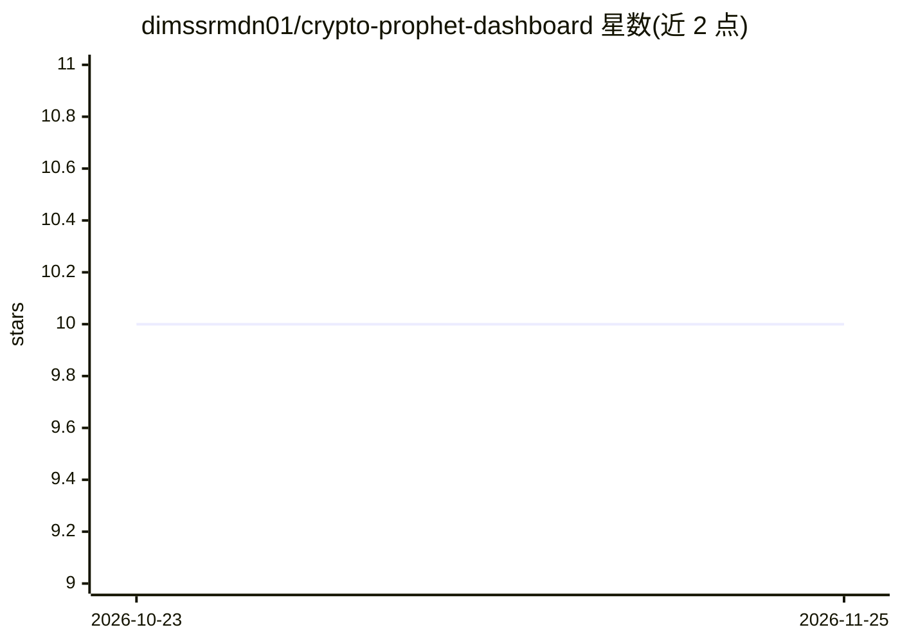

# dimssrmdn01/crypto-prophet-dashboard

⭐ 10 · HTML · 推送 2026-08-07 · [GitHub](https://github.com/dimssrmdn01/crypto-prophet-dashboard) · [官网](https://dimssrmdn01.github.io/crypto-prophet-dashboard/) · 个人维护

**面向加密货币/黄金/外汇的实时价格预测仪表盘**

前后端解耦的金融预测项目：前端为原生 HTML/CSS/JS 的单页界面，用户选择资产与预测周期，以内联 SVG 绘制历史与预测曲线；后端 FastAPI 实时抓取 Yahoo Finance 历史行情，按请求动态训练 Lasso 回归模型并返回预测结果。覆盖 Top 10 加密货币、黄金期货与 EUR/USD，支持日/周/月周期。README 声明其为教学性质的 Data Science 作品集项目，不提供投资建议。

## 筛选速览

| 维度 | 判定 | 备注 |
|---|---|---|
| AI 角色 | `ai-native` | 本体是模型或模型工具 |
| 许可风险 | `none` | — |
| 部署形态 | `library` | 以包/库形式分发 |
| 模型依赖 | — | README 未给出锁定关系 |
| 硬件要求 | — | 无带数字的原话,不猜 |
| 安装摩擦 | `low` | 无编译、无系统依赖或容器化 |
| 成熟度 | — | 结构信号不足 |

## 能力要点

- 实时抓取 Yahoo Finance 历史行情数据
- Lasso 回归（L1 正则化）作为主预测引擎，按请求即时训练与推理
- 支持 Top 10 加密货币、黄金期货与外汇多资产
- 原生 JS 实现的内联 SVG 交互图表，无重前端框架依赖

## 适用场景

- 查看 BTC 等主流加密货币未来一周的价格走势预测
- 对比黄金与 EUR/USD 在不同预测周期下的趋势输出
- 学习 FastAPI 与 scikit-learn 结合的端到端机器学习项目结构

## 场景标签

`金融量化` · 领域:学习与行业

## 证据(README 行号)

> L12: > An end-to-end project integrating a vanilla frontend with a high-performance FastAPI backend to predict Cryptocur
> L25: * **Instant Forecasting:** On-the-fly model training and inference based on user-defined forecast periods (Daily, W
> L69: This project is an educational Data Science portfolio piece. The predictive models are experimental and rely on sim

## 星数曲线

2026-10-23 10 → 2026-11-25 10（+0）

---
*卡片 v1 · prompt 1.4 · 生成 2026-11-19 · 置信度 high · 依据 README sha `76c212bf7a0c` · [字段定义](../../DATASET.md)*
