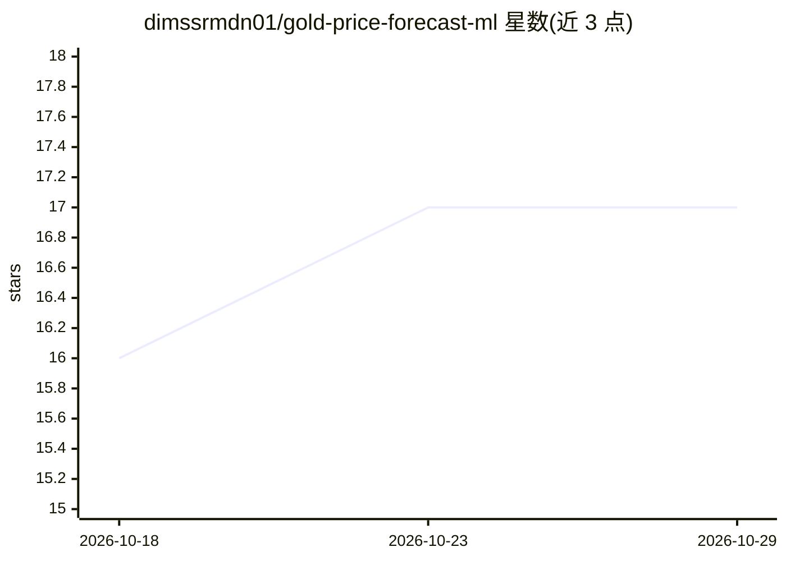

# dimssrmdn01/gold-price-forecast-ml

⭐ 17 · Python · 推送 2026-09-15 · [GitHub](https://github.com/dimssrmdn01/gold-price-forecast-ml) · [官网](https://dimas-xauusd-engine.streamlit.app) · 个人维护

**金融预测与回测仪表盘：LSTM/Lasso 预测价格并自带 LLM 分析代理**

基于 Streamlit 的量化研究仪表盘，默认针对 XAU/USD（可扩展到任意 Yahoo Finance 代码）。核心组件：PyTorch LSTM 与 Lasso 回归做次日价格预测（含 95% 置信区间与特征重要性）、vectorbt 滚动年度窗口的 walk-forward 回测、ATR 动态仓位与 MA 交叉信号、蒙特卡洛模拟。LLM 部分：通过 Groq API 调用 LLaMA-3.3-70B，配三个可调用工具读取预测、回测指标与实时新闻。限制：需 Groq API key，回测为模拟性质。

## 筛选速览

| 维度 | 判定 | 备注 |
|---|---|---|
| AI 角色 | `ai-native` | 本体是模型或模型工具 |
| 许可风险 | `none` | — |
| 部署形态 | `library` | 以包/库形式分发 |
| 模型依赖 | locked-api |  |
| 硬件要求 | — | 无带数字的原话,不猜 |
| 安装摩擦 | `low` | 无编译、无系统依赖或容器化 |
| 成熟度 | — | 结构信号不足 |

## 能力要点

- Lasso 与 PyTorch LSTM 双模型预测，scaler 仅在训练集拟合以防数据泄漏
- vectorbt walk-forward 回测按年窗口报告胜率/收益/最大回撤
- LLM 代理（LLaMA-3.3-70B via Groq）三个工具调用，禁止编造未运行的数据
- 模型经 joblib 持久化缓存，蒙特卡洛 500 路径模拟

## 适用场景

- 做多资产价格预测并对比 Lasso 与 LSTM 的 RMSE 表现
- 用滚动年度窗口检验交易策略在不同市场环境下的稳健性
- 在仪表盘中通过对话让 LLM 代理调取预测、回测与实时新闻

## 场景标签

`金融量化` · 领域:学习与行业

## 证据(README 行号)

> L49: **4. Deep Learning Forecaster (PyTorch LSTM)**
> L53: LLaMA-3.3-70B via Groq, with three callable tools: `get_predictions` (latest Lasso/LSTM output), `get_backtest` (wa

## 星数曲线

2026-10-18 16 → 2026-10-29 17（+1）

---
*卡片 v1 · prompt 1.4 · 生成 2026-10-29 · 置信度 mid · 依据 README sha `c165ff4fbbc1` · [字段定义](../../DATASET.md)*
