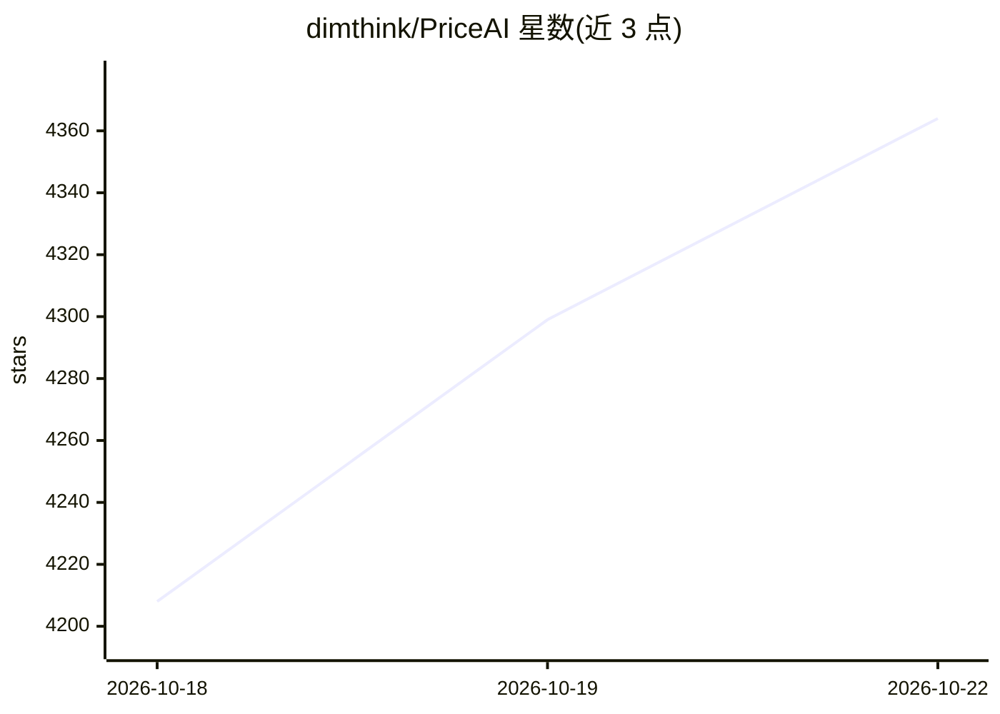

# dimthink/PriceAI

⭐ 4,364 · TypeScript · NOASSERTION · 推送 2026-09-28 · [GitHub](https://github.com/dimthink/PriceAI) · [官网](https://priceai.cc) · 个人维护 · 中文 README

**AI 订阅卡网与中转 API 比价工具：聚合 200+ 渠道报价**

基于 Next.js + Supabase 的 Web 比价应用：聚合 200+ AI 订阅卡网、发卡站与低价会员渠道，比较 ChatGPT、Claude、Gemini、Grok 等订阅及 DeepSeek/Qwen/Kimi 等官方 API 与中转 API 的价格、库存、倍率与来源，以官方价为基准展示有货最低价与原站链接，含后台管理与用户提交审核机制。另有独立的中转 API 模型检测服务（fork 自 veridrop，AGPL-3.0），运行协议探针生成证据报告。项目声明不做交易闭环、不收款、不担保渠道。

## 筛选速览

| 维度 | 判定 | 备注 |
|---|---|---|
| AI 角色 | `ai-knowledge` | 知识聚合/清单类 |
| 许可风险 | `none` | NOASSERTION |
| 部署形态 | `library` | 以包/库形式分发 |
| 模型依赖 | — | README 未给出锁定关系 |
| 硬件要求 | — | 无带数字的原话,不猜 |
| 安装摩擦 | `low` | 无编译、无系统依赖或容器化 |
| 成熟度 | — | 结构信号不足 |

## 能力要点

- 聚合 200+ 卡网/发卡站渠道，比较订阅价格、库存与交付方式
- 官方订阅、卡网、官方 API、中转 API 四类分开比较并保留风险标签
- 独立的 API 中转模型检测服务生成协议/能力/计费证据报告
- 支持社区提交渠道与站点资料，审核后进入公开列表

## 适用场景

- 购买 ChatGPT/Claude 等订阅前比较多渠道价格与库存
- 开发者比较 DeepSeek/Qwen/Kimi 等官方 API 与免费额度
- 选择 API 中转站前查看充值系数、倍率与可用性
- 控制多个 AI 产品叠加使用的长期成本

## 场景标签

`网页抓取` `模型评测` · 领域:效率与自动化

## 证据(README 行号)

> L6:  聚合 200+ AI 订阅卡网、发卡站和低价会员渠道，比较 ChatGPT Plus / Pro / Team、Claude Pro、Gemini、Grok、DeepSeek API、Qwen API、Kimi API 和 API
> L52: |卡网订阅|聚合 200+ AI 订阅卡网、发卡站和低价会员渠道，覆盖链动小铺、独角数卡、Kami / 卡密类自动发货等常见卡网形态，比较代充、成品号、卡密、CDK、邮箱和低价会员的有货报价|卡网订阅|
> L54: |中转 API|对比 API 中转站、API Gateway、GPT / Claude / Gemini 中转 API 的充值系数、模型倍率、综合倍率和稳定性|中转 API|

## 星数曲线

2026-10-18 4,208 → 2026-10-22 4,364（+156）

---
*卡片 v1 · prompt 1.4 · 生成 2026-10-20 · 置信度 high · 依据 README sha `a73c25caaa45` · [字段定义](../../DATASET.md)*
