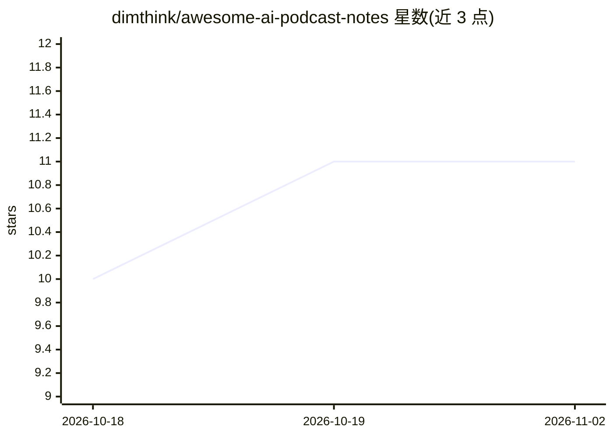

# dimthink/awesome-ai-podcast-notes

⭐ 11 · NOASSERTION · 推送 2026-11-01 · [GitHub](https://github.com/dimthink/awesome-ai-podcast-notes) · 个人维护 · 中文 README

**AI 长播客/YouTube 深度笔记开放资料库（983 篇）**

面向 AI 从业者、产品经理、研究者和独立开发者的开放笔记库：将长播客、YouTube 视频与技术访谈转换为 Markdown 笔记，提供深度笔记、结构化文稿与原始文稿三种版本，按频道（李弘毅、a16z、Latent Space 等 16 个）和时间线归档，并附主题索引。内容由 YouTube AI Deep Reader 自动生成并每日刷新，公开 data/episodes.json 等机器可读索引。README 声明内容为 AI 生成学习辅助资料，可能含转写错误或摘要偏差，引用前需核对原始来源。

## 筛选速览

| 维度 | 判定 | 备注 |
|---|---|---|
| AI 角色 | `ai-knowledge` | 知识聚合/清单类 |
| 许可风险 | `none` | NOASSERTION |
| 部署形态 | `None` |  |
| 模型依赖 | — | README 未给出锁定关系 |
| 硬件要求 | — | 无带数字的原话,不猜 |
| 安装摩擦 | `low` | 无编译、无系统依赖或容器化 |
| 成熟度 | — | 结构信号不足 |

## 能力要点

- 983 篇笔记覆盖 16 个频道，含 656 篇结构化文稿与 943 篇原始文稿
- 深度笔记/结构化文稿/原始文稿三种版本体系
- data/episodes.json 与 data/latest.json 机器可读索引
- 由 YouTube AI Deep Reader 自动生成并每日刷新

## 适用场景

- 系统跟踪 AI 产品、模型、Agent 与创业话题的长内容
- 快速判断一集长播客是否值得完整收听
- 基于公开笔记做检索、主题索引或二次整理

## 场景标签

`精选清单` · 领域:学习与行业

## 证据(README 行号)

> L7: 一个面向 AI 从业者、产品经理、研究者和独立开发者的 AI 长播客 / YouTube 深度笔记开放资料库。
> L9: 它不是一个单纯的播客列表，而是把长音频、长视频、技术访谈和 AI 领域对话转成可检索、可引用、可复盘的 Markdown 笔记库。
> L140: 本仓库由 YouTube AI Deep Reader 自动生成并每日刷新。公开版本不会暴露私有 Notion 链接，只保留原始来源链接，方便读者回到原视频或播客核对。

## 星数曲线

2026-10-18 10 → 2026-11-02 11（+1）

---
*卡片 v1 · prompt 1.4 · 生成 2026-11-02 · 置信度 high · 依据 README sha `68669614b02a` · [字段定义](../../DATASET.md)*
