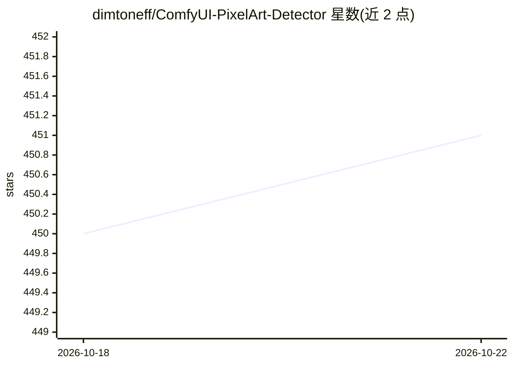

# dimtoneff/ComfyUI-PixelArt-Detector

⭐ 451 · Python · MIT · 推送 2025-10-31 · [GitHub](https://github.com/dimtoneff/ComfyUI-PixelArt-Detector) · 个人维护

**ComfyUI 像素画处理自定义节点集：生成/降采样/调色板替换像素图**

基于 Astropulse/pixeldetector 的 ComfyUI 自定义节点包，提供 6 个节点：一体化降色/缩放/保存节点、图像降采样与调色板缩减节点、调色板转换器、调色板加载器（内置 lospec 来源调色板与网格预览）、从图像生成调色板节点、抖动图案节点。支持 Image.quantize、OpenCV.kmeans、Pyclustering K-Means/K-Medians 等多种降色算法，可将 webp/jpeg 拖入 ComfyUI 加载工作流。以 git clone 到 custom_nodes 目录方式安装，需在 ComfyUI 内配合 SDXL/LoRa 使用。

## 筛选速览

| 维度 | 判定 | 备注 |
|---|---|---|
| AI 角色 | `ai-ecosystem` | LLM/agent 周边工具 |
| 许可风险 | `permissive` | MIT |
| 部署形态 | `None` |  |
| 模型依赖 | — | README 未给出锁定关系 |
| 硬件要求 | — | 无带数字的原话,不猜 |
| 安装摩擦 | `low` | 无编译、无系统依赖或容器化 |
| 成熟度 | — | 结构信号不足 |

## 能力要点

- 6 个像素画处理节点：检测转换、调色板加载/转换/生成、抖动图案
- 多种降色算法：Image.quantize、OpenCV.kmeans、Pyclustering K-Means/K-Medians
- webp/jpeg 文件拖入 ComfyUI UI 即可加载工作流
- 包含/放大/拉伸三种缩放模式并保持宽高比几何

## 适用场景

- 在 ComfyUI 里把 SDXL 生成的图转成像素风资产
- 给像素画替换为复古游戏调色板并添加抖动效果
- 从参考图提取配色生成调色板

## 场景标签

`图像生成` `图像视频处理` · 领域:内容生成

## 证据(README 行号)

> L97: This adds 6 custom nodes:
> L115: To use these nodes, simply open a terminal in **ComfyUI/custom_nodes/** and run:

## 星数曲线

2026-10-18 450 → 2026-10-22 451（+1）

---
*卡片 v1 · prompt 1.4 · 生成 2026-10-21 · 置信度 high · 依据 README sha `cfd88b6ab4d9` · [字段定义](../../DATASET.md)*
