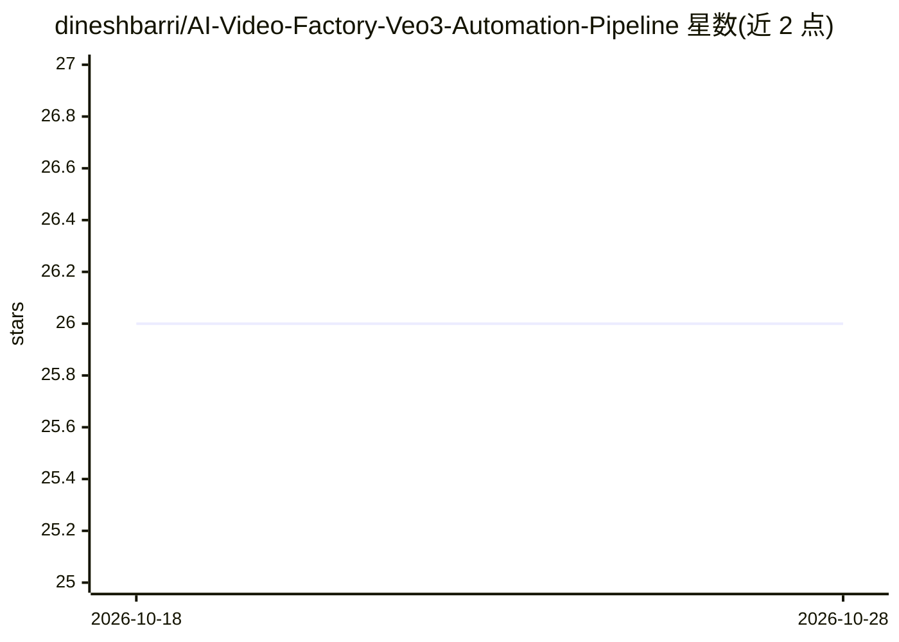

# dineshbarri/AI-Video-Factory-Veo3-Automation-Pipeline

⭐ 26 · MIT · 推送 2026-07-31 · [GitHub](https://github.com/dineshbarri/AI-Video-Factory-Veo3-Automation-Pipeline) · 个人维护

**n8n 自动化工作流：用 Veo3 生成视频并自动发布到 YouTube**

面向 n8n 用户的工作流项目：通过 Google Vertex AI 的 Veo3 模型从文本提示生成视频，用 Gemini/PaLM 生成标题、说明与标签，再将 Base64 输出转为 MP4，自动上传 Google Drive、发布 YouTube、记录 Google Sheets 并经 Gmail 发送通知。工作流含自适应重试（30s→60s→120s）与失败告警。使用需自备 Google API 凭据与 n8n 实例，作者给出每视频约 $0.26 的 API 成本估算。

## 筛选速览

| 维度 | 判定 | 备注 |
|---|---|---|
| AI 角色 | `ai-native` | 本体是模型或模型工具 |
| 许可风险 | `permissive` | MIT |
| 部署形态 | `None` |  |
| 模型依赖 | locked-api |  |
| 硬件要求 | — | 无带数字的原话,不猜 |
| 安装摩擦 | `low` | 无编译、无系统依赖或容器化 |
| 成熟度 | — | 结构信号不足 |

## 能力要点

- Veo3 文本生成视频，9:16 竖屏格式
- Gemini/PaLM 自动生成标题、标签与话题标签
- Drive/YouTube/Sheets/Gmail 全链路自动发布与日志
- 自适应等待与渐进退避重试，失败触发邮件告警

## 适用场景

- 定时批量生成并自动发布 AI 短视频到 YouTube
- 自动为视频生成标题、说明与标签
- 视频产出全流程留档到 Sheets 并邮件通知

## 场景标签

`工作流自动化` `视频生成` · 领域:效率与自动化

## 证据(README 行号)

> L13: The **AI Video Factory** is a modular, production-ready automation workflow that:
> L14: - Generates **AI videos via Veo3** (Google Vertex AI)
> L25: |🎥 **AI Video Generation**|Generates unique, cinematic videos from text prompts using Google Veo3.|

## 星数曲线

2026-10-18 26 → 2026-10-28 26（+0）

---
*卡片 v1 · prompt 1.4 · 生成 2026-10-26 · 置信度 high · 依据 README sha `f8928cb20fc1` · [字段定义](../../DATASET.md)*
