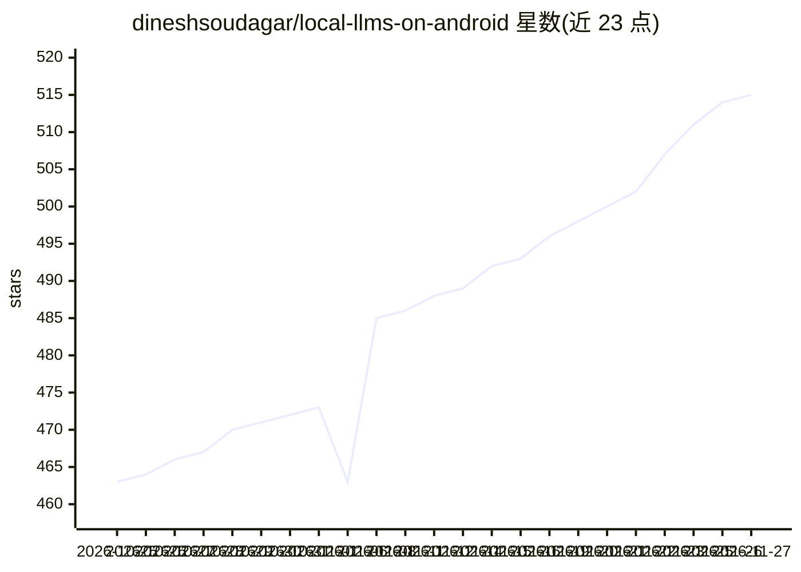

# dineshsoudagar/local-llms-on-android

⭐ 515 · Kotlin · MIT · 推送 2026-11-25 · [GitHub](https://github.com/dineshsoudagar/local-llms-on-android) · 个人维护

**在 Android 手机上离线运行本地 LLM 的聊天与服务应用**

将 Android 手机作为本地 LLM 运行环境的应用：支持端侧离线聊天、图片/PDF 问答（含 OCR）、离线语音听写与音频转写、局域网服务器（Web UI 与 OpenAI 兼容 API）。后端支持 ONNX 与 LiteRT，内置 Qwen2.5、Qwen3、DeepSeek R1 Distill、Gemma 4 模型列表，可导入自定义 .litertlm 文件。模型不打包在 APK 内，安装后按需下载。Google Play 版含 €2.99 一次性 Pro 工具（网页搜索、图像工具、离线翻译等）；上下文长度受手机内存限制，应用按内存设上限并在崩溃后下调。

## 筛选速览

| 维度 | 判定 | 备注 |
|---|---|---|
| AI 角色 | `ai-native` | 本体是模型或模型工具 |
| 许可风险 | `permissive` | MIT |
| 部署形态 | `None` |  |
| 模型依赖 | — | README 未给出锁定关系 |
| 硬件要求 | — | 无带数字的原话,不猜 |
| 安装摩擦 | `low` | 无编译、无系统依赖或容器化 |
| 成熟度 | — | 结构信号不足 |

## 能力要点

- ONNX 与 LiteRT 双后端，内置 6 个不同规格的移动端模型
- LAN 服务器提供 Web UI 与 OpenAI 兼容 API（/v1 端点）
- 离线 Whisper 听写/转写、PDF OCR、BM25 文档检索
- 支持导入自定义 .litertlm 模型与 Hugging Face 导入（Google Play 版 GGUF）

## 适用场景

- 在无网络环境下用手机离线聊天和翻译
- 把手机作为家庭局域网的本地 LLM 推理端点
- 在手机上对照片和 PDF 做提问与摘要
- 从浏览器或脚本通过 OpenAI 兼容 API 调用手机上的模型

## 场景标签

`聊天机器人` `文档问答` `语音识别` `OCR` · 领域:对话与助手

## 证据(README 行号)

> L3: Turn your Android phone into a **local LLM server for your home network**, or chat privately on-device with text, im
> L84: - 📱 **Local inference:** Run models on your phone with ONNX or LiteRT, offline after installation.
> L113: - 🌐 **LAN server:** Serve the phone's selected model to devices on the same private network.

## 星数曲线

2026-10-25 463 → 2026-11-27 515（+52）

---
*卡片 v1 · prompt 1.4 · 生成 2026-11-26 · 置信度 high · 依据 README sha `6a7ef06924cd` · [字段定义](../../DATASET.md)*
