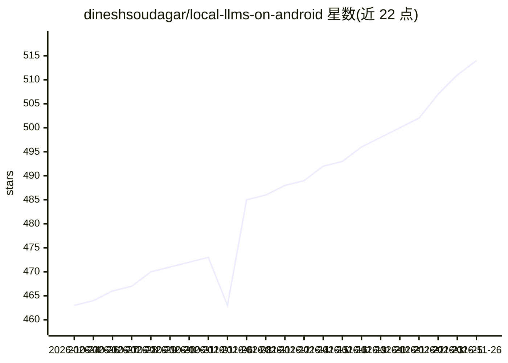

# dineshsoudagar/local-llms-on-android

⭐ 514 · Kotlin · MIT · 推送 2026-11-25 · [GitHub](https://github.com/dineshsoudagar/local-llms-on-android) · 个人维护

**让 Android 手机离线运行本地 LLM 的聊天与局域网服务应用**

Android 应用：在手机上通过 LiteRT 与 ONNX 两种后端本地运行 Gemma 4、Qwen、DeepSeek R1 Distill 等模型，支持离线多轮聊天、Markdown 渲染、上下文按手机内存自动封顶与超长对话自动压缩；可附加文本/PDF/图片/音频，带 OCR 与离线 Whisper 转写，文档问答用 BM25 选取相关段落；还提供局域网服务器、Web UI 与 OpenAI 兼容 API，供同网设备调用。模型不打包在 APK 内，需安装后在设备上下载。Google Play 版含 €2.99 买断的 Pro 功能。

## 筛选速览

| 维度 | 判定 | 备注 |
|---|---|---|
| AI 角色 | `ai-native` | 本体是模型或模型工具 |
| 许可风险 | `permissive` | MIT |
| 部署形态 | `None` |  |
| 模型依赖 | locked-api |  |
| 硬件要求 | — | 无带数字的原话,不猜 |
| 安装摩擦 | `low` | 无编译、无系统依赖或容器化 |
| 成熟度 | — | 结构信号不足 |

## 能力要点

- LiteRT 与 ONNX 双后端本地推理，安装后完全离线
- 局域网服务器提供 Web UI 与 OpenAI 兼容 API（/v1 端点）
- PDF/图片 OCR 与离线多语言 Whisper 转写，BM25 文档问答
- 上下文长度按手机内存封顶，原生崩溃后自动下调

## 适用场景

- 在无网络环境下在手机上私密对话与问答
- 把手机作为家庭局域网的共享推理端点，供电脑和其他设备调用
- 在手机上对扫描版 PDF、照片和录音做识别与问答

## 场景标签

`聊天机器人` `文档问答` `OCR` `语音识别` · 领域:对话与助手

## 证据(README 行号)

> L76: - 📱 **Local inference:** Run models on your phone with ONNX or LiteRT, offline after installation.
> L105: - 🌐 **LAN server:** Serve the phone's selected model to devices on the same private network.
> L199: This app supports **ONNX-based Qwen models** and **LiteRT-based Qwen 3 and Gemma 4 models**.

## 星数曲线

2026-10-24 463 → 2026-11-26 514（+51）

---
*卡片 v1 · prompt 1.4 · 生成 2026-11-25 · 置信度 high · 依据 README sha `0e95ea80f7a3` · [字段定义](../../DATASET.md)*
