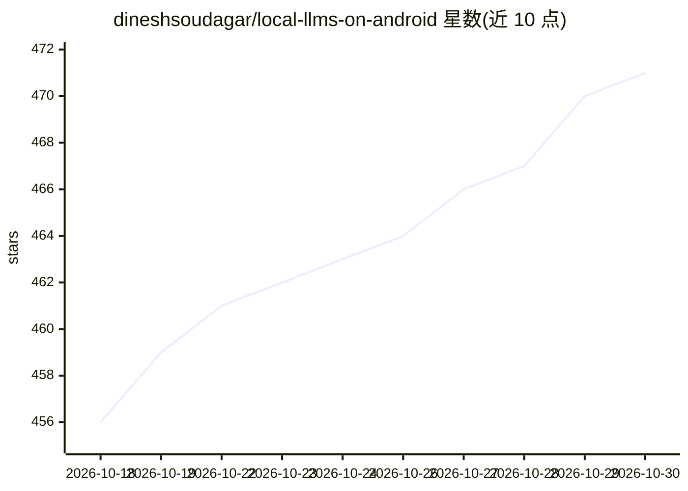

# dineshsoudagar/local-llms-on-android

⭐ 471 · Kotlin · MIT · 推送 2026-10-27 · [GitHub](https://github.com/dineshsoudagar/local-llms-on-android) · 个人维护

**在 Android 手机上离线运行本地 LLM 聊天与局域网推理服务器的应用**

Android 应用，把手机变成本地 LLM 运行环境：应用内或 PC 浏览器 Web UI 中与模型离线聊天，支持多轮对话、图片 OCR/原生视觉输入、PDF/文本附件与 BM25 检索问答、离线多语言 Whisper 语音转写与听写。内置 Qwen2.5/Qwen3/DeepSeek R1 Distill/Gemma 4 等模型下载，运行于 ONNX 与 LiteRT 后端，支持 Thinking 模式与导入自定义 .litertlm 模型（beta）。另可将手机作为局域网 LLM 服务器，暴露 OpenAI 兼容 API 供 Open WebUI、OpenCode 等客户端调用。限制：自定义模型兼容性实验性，大模型/大上下文可能崩溃，工具调用对自定义模型不可用。

## 筛选速览

| 维度 | 判定 | 备注 |
|---|---|---|
| AI 角色 | `ai-native` | 本体是模型或模型工具 |
| 许可风险 | `permissive` | MIT |
| 部署形态 | `None` |  |
| 模型依赖 | — | README 未给出锁定关系 |
| 硬件要求 | — | 无带数字的原话,不猜 |
| 安装摩擦 | `low` | 无编译、无系统依赖或容器化 |
| 成熟度 | `idea` | |

## 能力要点

- ONNX 与 LiteRT 双后端，内置 6 种可选模型（Qwen/Gemma/DeepSeek R1 Distill）
- 局域网服务器模式，提供密码保护的 Web UI 与 OpenAI 兼容 API（:8080/v1）
- 离线多语言 Whisper 转写、PDF/扫描件 OCR、BM25 文档问答
- 推理与聊天数据留在手机，无遥测

## 适用场景

- 在手机上完全离线地与本地 LLM 聊天和问答
- 把旧手机当作家庭网络的共享推理端点，供 PC 或脚本调用
- 对 PDF 和图片做离线提问与文字提取
- 用离线语音听写代替键盘输入

## 场景标签

`聊天机器人` `文档问答` `语音识别` `推理引擎` · 领域:对话与助手

## 证据(README 行号)

> L3: Turn your Android phone into a **local LLM server for your home network**, or chat privately on-device with text, im
> L73: - 📱 **Local inference:** Run models on your phone with ONNX or LiteRT, offline after installation.
> L105: - 🔌 **OpenAI-compatible API:** Connect compatible clients through model and chat-completion endpoints.

## 星数曲线

2026-10-18 456 → 2026-10-30 471（+15）

---
*卡片 v1 · prompt 1.4 · 生成 2026-10-21 · 置信度 high · 依据 README sha `dcae2f47f4a0` · [字段定义](../../DATASET.md)*
