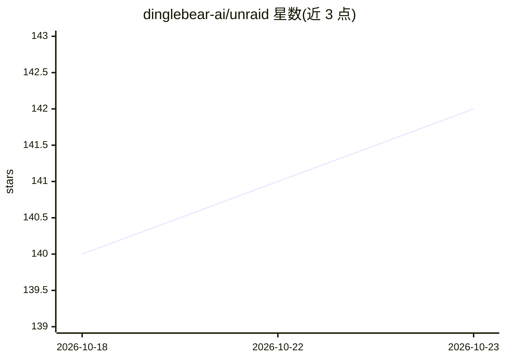

# dinglebear-ai/unraid

⭐ 142 · Python · MIT · 推送 2026-10-22 · [GitHub](https://github.com/dinglebear-ai/unraid) · 组织维护

**通过 MCP 工具查询与管理 Unraid 服务器的工具集**

围绕 Unraid NAS 服务器的 monorepo：包含两个 MCP 服务器（Python 的 unraid-mcp 与 Rust 的 runraid，均通过 GraphQL API 读取/操作 Docker、VM、阵列/校验、通知、插件、rclone 与实时遥测）和三个 Unraid OS 插件（MCP 分发、Incus 系统容器、Codex chathead）。提供 Claude Code / Codex 插件接入，Python 版发布到 PyPI，Rust 版以静态二进制与 crates.io crate 发布。Rust 服务器同时暴露查询与变更操作，变更需 unraid:admin 权限，非只读。

## 筛选速览

| 维度 | 判定 | 备注 |
|---|---|---|
| AI 角色 | `ai-ecosystem` | LLM/agent 周边工具 |
| 许可风险 | `permissive` | MIT |
| 部署形态 | `library` | 以包/库形式分发 |
| 模型依赖 | — | README 未给出锁定关系 |
| 硬件要求 | — | 无带数字的原话,不猜 |
| 安装摩擦 | `low` | 无编译、无系统依赖或容器化 |
| 成熟度 | — | 结构信号不足 |

## 能力要点

- Python（PyPI/uvx）与 Rust（静态二进制/crates.io）双 MCP 服务器实现
- 通过 Unraid GraphQL API 覆盖 Docker、VM、阵列/校验、通知、插件、rclone 与实时遥测
- Claude Code / Codex 插件一键 marketplace 安装，凭据经 userConfig 直接注入环境变量
- Rust 服务器支持读写分级权限（unraid:read / unraid:admin）与 bearer/oauth 认证

## 适用场景

- 在 Claude Code 或 Codex 中用自然语言查询和操作我的 Unraid 服务器
- 通过 MCP 对 Unraid 的 Docker 容器与 VM 做生命周期管理
- homelab 场景下让 agent 监控阵列/校验状态与实时遥测

## 场景标签

 · 领域:服务器运维/MCP 工具

## 证据(README 行号)

> L5: A monorepo of Unraid tooling: two MCP servers (Python and Rust) and three Unraid
> L18: |`unraid-py/`|**unraid-mcp** — Python MCP server (GraphQL), the flagship. Published to PyPI as `unraid-mcp`.|Python
> L63: The Python server is the flagship. Full documentation — installation, Claude

## 星数曲线

2026-10-18 140 → 2026-10-23 142（+2）

---
*卡片 v1 · prompt 1.4 · 生成 2026-10-22 · 置信度 mid · 依据 README sha `14b88baf24ad` · [字段定义](../../DATASET.md)*
