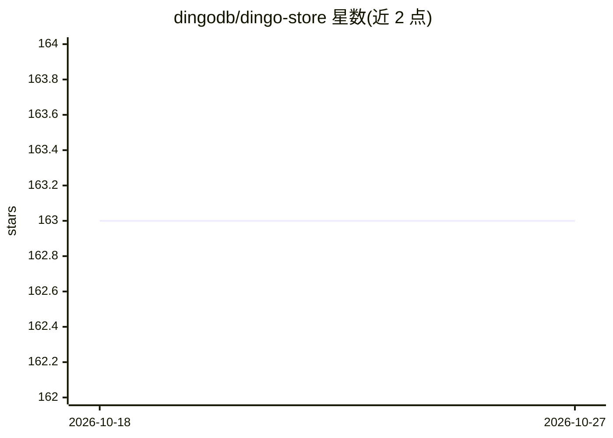

# dingodb/dingo-store

⭐ 163 · C++ · Apache-2.0 · 推送 2026-09-11 · [GitHub](https://github.com/dingodb/dingo-store) · [官网](https://www.dingodb.com) · 组织维护

**基于多 Raft 组的分布式 KV 存储层，支撑 DingoDB**

DingoDB 的存储集群组件，采用多 Raft 复制组保证数据一致性，包含 Coordinator（元数据管理，建议至少三节点）、Store（多副本 KV 读写、日志复制、Leader 选举、自动分裂）与 Index（高维向量实时索引，支持 HNSW 与 IVF 格式）三种角色，并支持存储层计算下推。C++/Java 混合工程：C++ 提供存储与计算，Java 层提供基础 API，需通过 CMake 与 Maven 从源码构建。

## 筛选速览

| 维度 | 判定 | 备注 |
|---|---|---|
| AI 角色 | `ai-ecosystem` | LLM/agent 周边工具 |
| 许可风险 | `permissive` | Apache-2.0 |
| 部署形态 | `None` |  |
| 模型依赖 | — | README 未给出锁定关系 |
| 硬件要求 | — | 无带数字的原话,不猜 |
| 安装摩擦 | `low` | 无编译、无系统依赖或容器化 |
| 成熟度 | — | 结构信号不足 |

## 能力要点

- 多 Raft 复制组：日志复制、Leader 选举、Raft 组迁移、快照安装、按数据量自动分裂
- Index 角色提供高维向量实时构建与索引，支持 HNSW 与 IVF
- 存储层计算下推能力
- Release 镜像附带 DWARF 调试符号 sidecar 镜像

## 适用场景

- 作为 DingoDB 的底层分布式 KV 存储集群部署
- 为高频率键值读写业务提供多副本存储
- 构建高维向量索引支撑向量检索场景

## 场景标签

`向量数据库` · 领域:知识与检索

## 证据(README 行号)

> L9: The Dingo-Store project is a distributed KV storage system based on multiple Raft replication groups, which also pro
> L25: Dingo-Index is a specialized version of Dingo-Store. It not only offers distributed data storage capabilities but a

## 星数曲线

2026-10-18 163 → 2026-10-27 163（+0）

---
*卡片 v1 · prompt 1.4 · 生成 2026-10-22 · 置信度 mid · 依据 README sha `4c460a6c00e2` · [字段定义](../../DATASET.md)*
