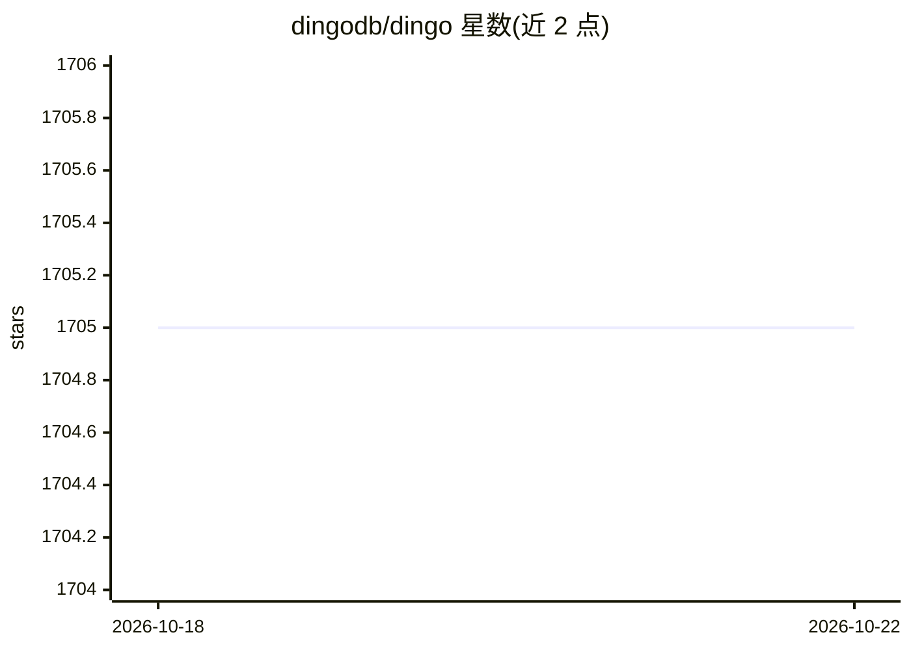

# dingodb/dingo

⭐ 1,705 · Java · Apache-2.0 · 推送 2026-09-23 · [GitHub](https://github.com/dingodb/dingo) · [官网](https://www.dingodb.com) · 组织维护 · 中文 README

**DataCanvas 开源的分布式多模态向量数据库，SQL 与向量统一检索**

DingoDB 是 DataCanvas 自研的开源分布式多模态向量数据库，把关系语义与向量语义整合在同一平台，兼容 MySQL 协议，支持 SQL、SDK、API 多种访问方式。提供 Table 与 Vector 作为一等数据模型、标量-向量混合检索、实时索引构建、冷热分层检索与全自动弹性分片；内置数据高可用，无需部署外部组件。README 仅指引 Docker/Ansible 部署文档，未给出具体安装命令；采用 Apache License 2.0。

## 筛选速览

| 维度 | 判定 | 备注 |
|---|---|---|
| AI 角色 | `ai-ecosystem` | LLM/agent 周边工具 |
| 许可风险 | `permissive` | Apache-2.0 |
| 部署形态 | `None` |  |
| 模型依赖 | — | README 未给出锁定关系 |
| 硬件要求 | — | 无带数字的原话,不猜 |
| 安装摩擦 | `low` | 无编译、无系统依赖或容器化 |
| 成熟度 | — | 结构信号不足 |

## 能力要点

- MySQL 协议兼容，SQL/SDK/API 多访问接口
- 标量-向量混合检索与分布式事务
- 实时索引构建与后台自动索引优化
- 基于磁盘的向量检索支持冷热分层

## 适用场景

- 存储结构化与非结构化数据并做统一 SQL 向量查询
- 高并发低时延场景下的 embedding 检索与 upsert
- 需要内置高可用、免外部组件的分布式数据存储

## 场景标签

`向量数据库` · 领域:知识与检索

## 证据(README 行号)

> L2: DingoDB is an open-source distributed multi-modal vector database independently designed and developed by DataCanvas
> L20: DingoDB supports both traditional database index types and various vector index types, providing a seamless scalar 

## 星数曲线

2026-10-18 1,705 → 2026-10-22 1,705（+0）

---
*卡片 v1 · prompt 1.4 · 生成 2026-10-21 · 置信度 mid · 依据 README sha `478963c5f740` · [字段定义](../../DATASET.md)*
