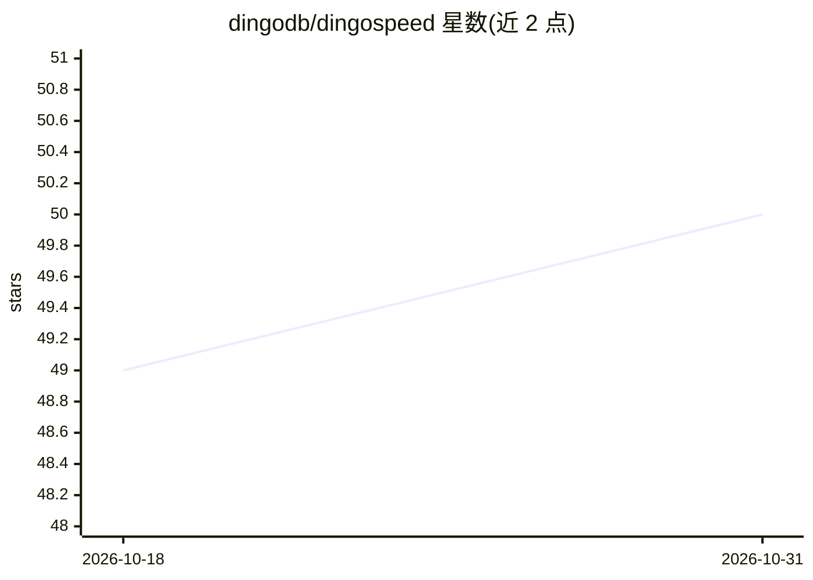

# dingodb/dingospeed

⭐ 50 · Go · NOASSERTION · 推送 2026-10-21 · [GitHub](https://github.com/dingodb/dingospeed) · 组织维护 · 中文 README

**自托管的 Hugging Face 镜像加速服务**

DingoSpeed 是可自部署的 Hugging Face 镜像服务：缓存首次下载的模型与数据集，客户端通过设置 HF_ENDPOINT 将 huggingface_hub / CLI 的下载请求代理至本地镜像，实现加速下载、断点续传、多版本快照存储与流量节省。支持多节点协同缓存与调度、LRU/FIFO 等磁盘清理策略，集成 Prometheus+Grafana 运行监控。源码以 Go 编写，需 Go 1.23+ 与 make 编译，部署二进制后 ./dingospeed 启动。

## 筛选速览

| 维度 | 判定 | 备注 |
|---|---|---|
| AI 角色 | `ai-ecosystem` | LLM/agent 周边工具 |
| 许可风险 | `none` | NOASSERTION |
| 部署形态 | `library` | 以包/库形式分发 |
| 模型依赖 | — | README 未给出锁定关系 |
| 硬件要求 | — | 无带数字的原话,不猜 |
| 安装摩擦 | `low` | 无编译、无系统依赖或容器化 |
| 成熟度 | — | 结构信号不足 |

## 能力要点

- 兼容 HF Hub 规范的 HTTP API，支持模型与数据集下载
- 多节点协同缓存与智能调度，支持故障回退源站下载
- LRU/FIFO/LARGE_FIRST 磁盘清理策略与阈值触发
- 集成 Prometheus + Grafana 实时监控下载状态

## 适用场景

- 内网或受限网络环境下加速获取 Hugging Face 模型
- 团队多节点共享缓存，避免重复下载同一模型
- 企业对模型资源做本地化存储与运维监控

## 场景标签

 · 领域:AI 基础设施/模型分发

## 证据(README 行号)

> L4: DingoSpeed is a self-hosted Hugging Face mirror service designed to provide users with a convenient and efficient so
> L15: 1. [x] implements HTTP RESTful API (compatible with HF Hub specification), supports model and dataset download;

## 星数曲线

2026-10-18 49 → 2026-10-31 50（+1）

---
*卡片 v1 · prompt 1.4 · 生成 2026-10-24 · 置信度 mid · 依据 README sha `603cc186ee0f` · [字段定义](../../DATASET.md)*
