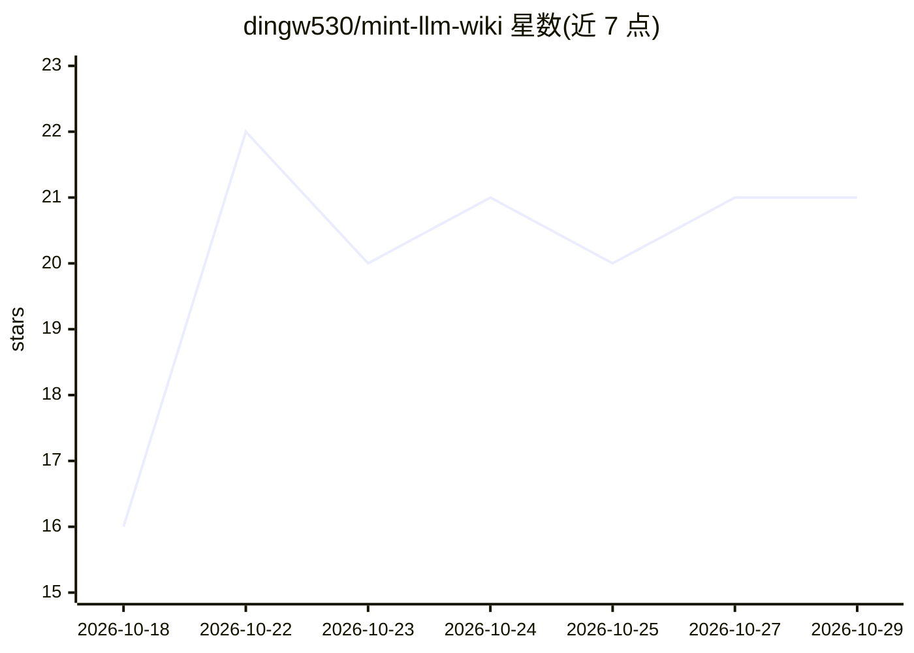

# dingw530/mint-llm-wiki

⭐ 21 · TypeScript · MIT · 推送 2026-10-23 · [GitHub](https://github.com/dingw530/mint-llm-wiki) · [官网](https://dingw530.github.io/mint-llm-wiki/) · 个人维护 · 中文 README

**本地优先的个人 AI 知识工作台：把资料编译成 Wiki 供 Agent 使用**

面向个人知识管理的桌面/Web 应用：将文档、网页与对话整理为本地 Markdown Wiki，基于 SQLite 与 sqlite-vec（可配置 Chroma）做全文与向量混合检索，Agent 通过 ReAct 循环调用工具、引用检索证据并回答问题，支持长期记忆、来源追溯与审批暂停的运行恢复。模型与 Embedding 使用用户配置的 OpenAI-compatible 端点，应用数据默认保存在本机。附带 Wiki-RAG 评测套件（apps/agent-eval/）。限制：HTTP API 无用户认证，Docker Compose 仅默认发布到 localhost。

## 筛选速览

| 维度 | 判定 | 备注 |
|---|---|---|
| AI 角色 | `ai-native` | 本体是模型或模型工具 |
| 许可风险 | `permissive` | MIT |
| 部署形态 | `self-host` | docker 或自建部署 |
| 模型依赖 | — | README 未给出锁定关系 |
| 硬件要求 | — | 无带数字的原话,不猜 |
| 安装摩擦 | `low` | 无编译、无系统依赖或容器化 |
| 成熟度 | — | 结构信号不足 |

## 能力要点

- 本地 Wiki 混合检索（全文+sqlite-vec/Chroma 向量，RRF 排序，可选 Jev 重排）
- 可移植 ReAct 核心与工具运行时（注册、校验、授权、审批、超时）
- AgentRun 事件持久化与中断后 Reducer 状态重建，未知工具结果不自动重放
- 每轮按 token budget 压缩上下文，大工具结果存为 artifact

## 适用场景

- 把个人文档、网页收藏和对话沉淀为可持续积累的知识库并问答
- 通过带来源引用的 Agent 检索和复用本地知识
- 在本地运行端到端的知识问答与工具调用工作流

## 场景标签

`知识库管理` `RAG` `文档问答` · 领域:知识与检索

## 证据(README 行号)

> L8: **Mint 是一款个人知识工作台：把资料编译成可追溯的 Wiki，再由 Agent 在受治理、可恢复的 Runtime 中使用知识和工具。**
> L14: Mint 将文档、网页和对话整理为本地 Wiki，提供知识检索、来源引用、Agent 工具调用和长期记忆。它以 Electron 提供桌面应用，也支持通过 Web 运行。

## 星数曲线

2026-10-18 16 → 2026-10-29 21（+5）

---
*卡片 v1 · prompt 1.4 · 生成 2026-10-28 · 置信度 mid · 依据 README sha `1145255dfec5` · [字段定义](../../DATASET.md)*
