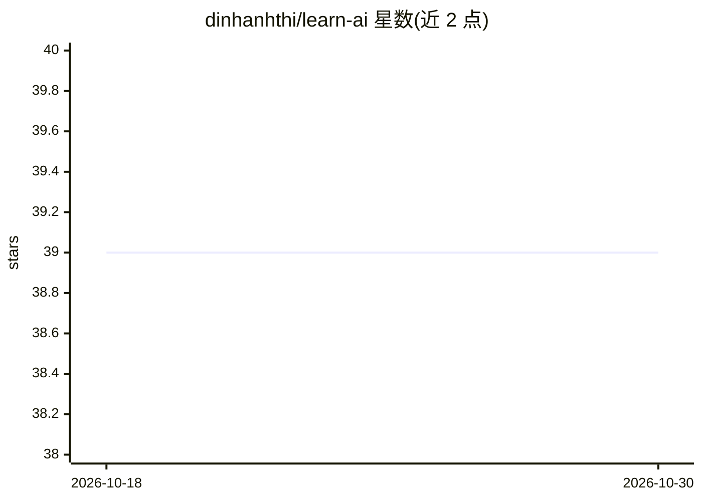

# dinhanhthi/learn-ai

⭐ 39 · Jupyter Notebook · 推送 2026-03-02 · [GitHub](https://github.com/dinhanhthi/learn-ai) · [官网](https://dinhanhthi.com) · 个人维护

**个人自学机器学习与数据科学的课程与项目集合**

个人维护的学习仓库，收录作者自学 Machine Learning 与 Data Science 过程中的课程笔记、作业、练习、小项目与书籍内容，涉及 Coursera、Dataquest、deeplearning.ai、Kaggle 等来源，主要在 Jupyter Notebook / Google Colab 中组织，主题含深度学习、PCA 等概念。README 本身内容极少（仅标题与一句提示），具体结构需查看仓库目录。属于学习资源汇编，非可安装运行的软件产品。

## 筛选速览

| 维度 | 判定 | 备注 |
|---|---|---|
| AI 角色 | `ai-knowledge` | 知识聚合/清单类 |
| 许可风险 | `none` | — |
| 部署形态 | `None` |  |
| 模型依赖 | — | README 未给出锁定关系 |
| 硬件要求 | — | 无带数字的原话,不猜 |
| 安装摩擦 | `low` | 无编译、无系统依赖或容器化 |
| 成熟度 | — | 结构信号不足 |

## 能力要点

- 收录课程、作业、练习、小项目与书籍学习记录
- 内容以 Jupyter Notebook / Google Colab 形式组织
- 覆盖深度学习、PCA 等机器学习概念

## 适用场景

- 参考他人自学机器学习与数据科学的路径与资料
- 查找课程作业与练习的实现示例

## 场景标签

`教程课程` · 领域:学习与行业

## 证据(README 行号)

> L1: # 📊 Learn AI

## 星数曲线

2026-10-18 39 → 2026-10-30 39（+0）

---
*卡片 v1 · prompt 1.4 · 生成 2026-10-25 · 置信度 low · 依据 README sha `b91313dc8ac0` · [字段定义](../../DATASET.md)*
