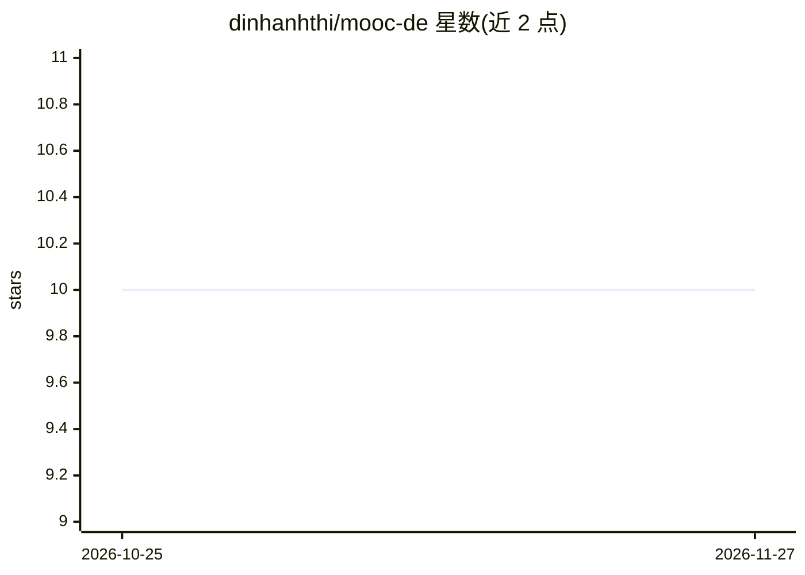

# dinhanhthi/mooc-de

⭐ 10 · Jupyter Notebook · 推送 2026-06-27 · [GitHub](https://github.com/dinhanhthi/mooc-de) · [官网](https://dinhanhthi.com/tag/mooc-de/) · 个人维护

**学习笔记：DeepLearning.AI 数据工程课程资源整理**

作者学习 DeepLearning.AI 在 Coursera 提供的数据工程课程时整理的资源与个人笔记合集。以仓库形式汇总课程相关资源，并附作者自己的学习笔记。内容围绕课程学习材料组织，未在 README 中说明额外的安装或运行方式。

## 筛选速览

| 维度 | 判定 | 备注 |
|---|---|---|
| AI 角色 | `ai-knowledge` | 知识聚合/清单类 |
| 许可风险 | `none` | — |
| 部署形态 | `None` |  |
| 模型依赖 | — | README 未给出锁定关系 |
| 硬件要求 | — | 无带数字的原话,不猜 |
| 安装摩擦 | `low` | 无编译、无系统依赖或容器化 |
| 成熟度 | — | 结构信号不足 |

## 能力要点

- 汇总该 Coursera 课程的学习资源
- 包含作者个人的课程笔记

## 适用场景

- 学习该数据工程课程时查阅配套资源
- 参考他人课程笔记辅助复习

## 场景标签

`教程课程` · 领域:学习与行业

## 证据(README 行号)

> L3: Resources for the course Data Engineering provided by DeepLearning.AI.
> L5: My notes for this course.

## 星数曲线

2026-10-25 10 → 2026-11-27 10（+0）

---
*卡片 v1 · prompt 1.4 · 生成 2026-11-19 · 置信度 high · 依据 README sha `f01307272949` · [字段定义](../../DATASET.md)*
