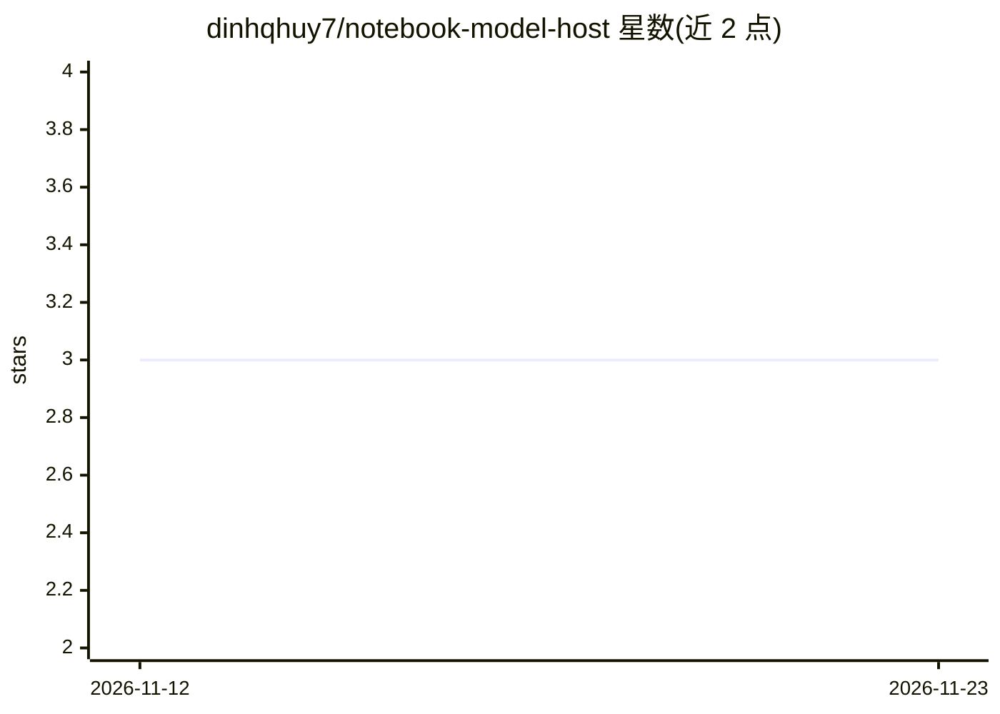

# dinhqhuy7/notebook-model-host

⭐ 3 · Jupyter Notebook · MIT · 推送 2026-11-14 · [GitHub](https://github.com/dinhqhuy7/notebook-model-host) · 个人维护

**在 Colab/Kaggle 上用 vLLM 托管开源模型的现成笔记本**

一组预构建的 Google Colab 与 Kaggle 笔记本：在免费 GPU 上以 vLLM 启动 Qwen 系列开源模型，经密钥校验代理与 Cloudflare Tunnel 暴露为 OpenAI 兼容 API。笔记本内置代理与隧道，无需编写托管代码；README 提供 19 个模型的权重体积、各 GPU 显存余量表与实测数据，并说明 URL 每次运行会变、非流式请求 100 秒截断、仅适合个人或小团体使用等限制。另有脚本可按任意模型生成自有笔记本。

## 筛选速览

| 维度 | 判定 | 备注 |
|---|---|---|
| AI 角色 | `ai-ecosystem` | LLM/agent 周边工具 |
| 许可风险 | `permissive` | MIT |
| 部署形态 | `library` | 以包/库形式分发 |
| 模型依赖 | local-ok | 支持本地模型 |
| 硬件要求 | — | 无带数字的原话,不猜 |
| 安装摩擦 | `low` | 无编译、无系统依赖或容器化 |
| 成熟度 | — | 结构信号不足 |

## 能力要点

- 笔记本内置密钥校验代理与 Cloudflare Tunnel，无需编写托管代码
- 暴露 OpenAI 兼容 API，另有 Anthropic 风格 /v1/messages 与 /rerank、/score 端点
- 提供各模型在 T4/L4/A100/H100 等 GPU 上的显存余量与实测数据表
- tools/build_notebooks.py 可为任意模型生成自有笔记本

## 适用场景

- 在 Colab 免费 GPU 上临时托管一个模型供自己调用
- 给个人项目提供一个带密钥保护的 OpenAI 兼容推理端点
- 为 Qwen 系列之外的模型生成自己的托管笔记本

## 场景标签

`推理引擎` · 领域:训练与推理

## 证据(README 行号)

> L5: Pre-built notebooks that serve an open model with vLLM on a
> L6: Colab or Kaggle GPU and expose it to the Internet as a **key-protected, OpenAI-compatible API**. No
> L121: The first run takes about 7–15 minutes. Step 8 prints the **Base URL** and **API key**. Keep the tab

## 星数曲线

2026-11-12 3 → 2026-11-23 3（+0）

---
*卡片 v1 · prompt 1.4 · 生成 2026-11-22 · 置信度 mid · 依据 README sha `cb7679461419` · [字段定义](../../DATASET.md)*
