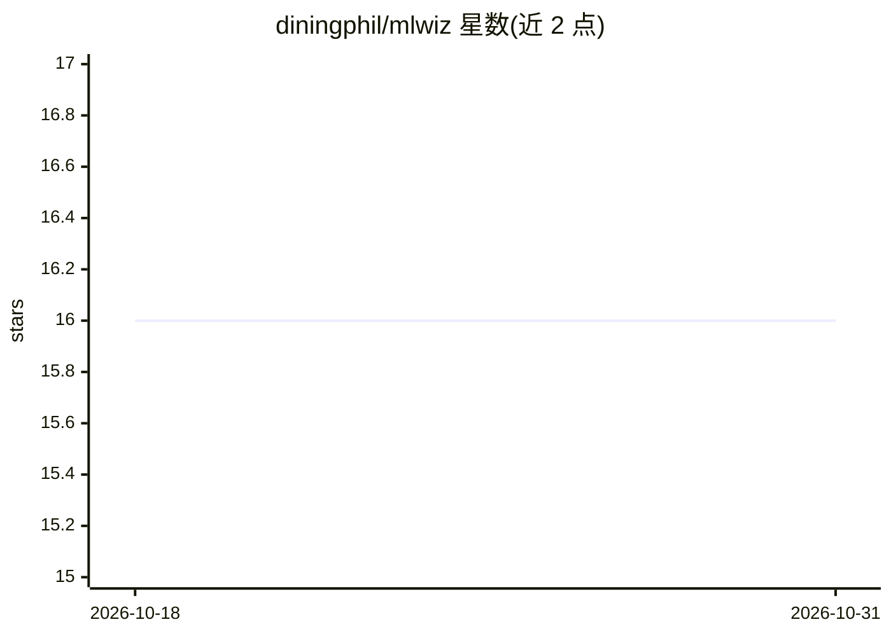

# diningphil/mlwiz

⭐ 16 · Python · BSD-3-Clause · 推送 2026-10-27 · [GitHub](https://github.com/diningphil/mlwiz) · 个人维护

**ML 研究实验框架：用 YAML 配置复现模型选择与风险评估**

面向机器学习研究者的实验编排框架：通过两个 YAML（数据+划分、实验+搜索空间）驱动全流程——`mlwiz-data` 生成数据集与 hold-out/嵌套 CV 划分，`mlwiz-exp` 基于 Ray 在 CPU/GPU 或集群并行执行超参搜索（网格/随机/贝叶斯）、内层模型选择与外层风险评估，输出结构化结果到 `RESULTS/`。附带本地只读可视化仪表盘，可将图表导出为 Matplotlib+tueplots 代码，并支持生成 `.mlwiz` 共享文件。支持向量、图像、时序与图数据，是 PyDGN 的泛化版本。

## 筛选速览

| 维度 | 判定 | 备注 |
|---|---|---|
| AI 角色 | `ai-ecosystem` | LLM/agent 周边工具 |
| 许可风险 | `permissive` | BSD-3-Clause |
| 部署形态 | `library` | 以包/库形式分发 |
| 模型依赖 | — | README 未给出锁定关系 |
| 硬件要求 | — | 无带数字的原话,不猜 |
| 安装摩擦 | `low` | 无编译、无系统依赖或容器化 |
| 成熟度 | — | 结构信号不足 |

## 能力要点

- YAML 配置驱动：数据划分、搜索空间与实验执行分离
- Ray 并行执行嵌套模型选择（内层）与风险评估（外层）
- 本地只读仪表盘，图表可导出为可复现的 Matplotlib+tueplots Python 代码
- Hydra 风格模块化配置组合与点路径引用自定义代码

## 适用场景

- 研究者以最小样板运行可复现的 ML 实验
- 对多种超参配置做嵌套模型选择与性能评估
- 浏览与对比实验运行历史并导出论文级图表

## 场景标签

`MLOps` `科研工具` · 领域:学习与行业

## 证据(README 行号)

> L4: _Machine Learning Research Wizard — reproducible experiments from YAML (model selection + risk assessment) for vecto
> L27: - ⚡ Run model selection + risk assessment in parallel with Ray (CPU/GPU or cluster)
> L39: |Automatic and Robust Evaluation|Nested model selection (inner folds) + risk assessment (outer folds)|

## 星数曲线

2026-10-18 16 → 2026-10-31 16（+0）

---
*卡片 v1 · prompt 1.4 · 生成 2026-10-30 · 置信度 high · 依据 README sha `5f7e541d839c` · [字段定义](../../DATASET.md)*
