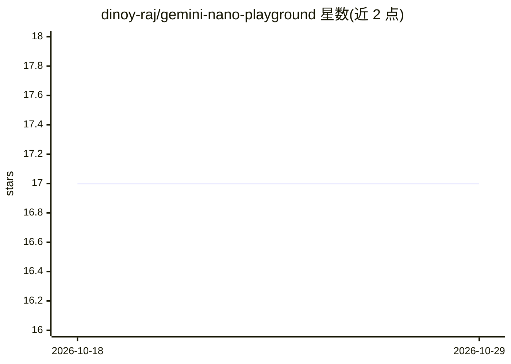

# dinoy-raj/gemini-nano-playground

⭐ 17 · Kotlin · Apache-2.0 · 推送 2026-10-18 · [GitHub](https://github.com/dinoy-raj/gemini-nano-playground) · [官网](https://play.google.com/store/apps/details?id=com.dino.nanoplayground) · 个人维护

**在安卓手机上直接试用 Gemini Nano 本地模型的应用**

Android 应用，通过 ML Kit GenAI Prompt API（com.google.mlkit:genai-prompt）调用设备本地的 Google Gemini Nano 模型进行文本对话实验。功能包括模型可用性检查与下载进度、流式逐 token 响应、推理耗时/Token 数/结束原因统计、任意应用分享文本作为提示词、显示模型版本与 Token 上限、清除模型缓存。Kotlin + Jetpack Compose 编写，MVVM 架构。通过 Google Play 分发，也可源码构建；仅限支持 AICore 的实体设备，模拟器不可运行，首次启动可能需下载模型。

## 筛选速览

| 维度 | 判定 | 备注 |
|---|---|---|
| AI 角色 | `ai-native` | 本体是模型或模型工具 |
| 许可风险 | `permissive` | Apache-2.0 |
| 部署形态 | `None` |  |
| 模型依赖 | — | README 未给出锁定关系 |
| 硬件要求 | — | 无带数字的原话,不猜 |
| 安装摩擦 | `low` | 无编译、无系统依赖或容器化 |
| 成熟度 | — | 结构信号不足 |

## 能力要点

- 经 ML Kit Prompt API 调用本地 Gemini Nano，提示词不出设备
- 流式响应与推理统计（耗时/Token 数/结束原因）
- 自动检查模型可用性并提供下载进度与错误界面
- 支持从任意应用分享文本作为提示词

## 适用场景

- 在支持的安卓设备上体验端侧 Gemini Nano 的响应速度
- 查看设备上 Nano 模型版本与 Token 上限
- 把其他应用的文本分享过来直接生成回答

## 场景标签

`聊天机器人` · 领域:对话与助手

## 证据(README 行号)

> L15: Nano Playground is an Android application designed to test and experiment with Google's on-device Generative AI mod
> L94: * **Streaming Responses**: Responses are streamed token by token using `generateContentStream` for a responsive "ty

## 星数曲线

2026-10-18 17 → 2026-10-29 17（+0）

---
*卡片 v1 · prompt 1.4 · 生成 2026-10-29 · 置信度 high · 依据 README sha `d225cb82ddd9` · [字段定义](../../DATASET.md)*
