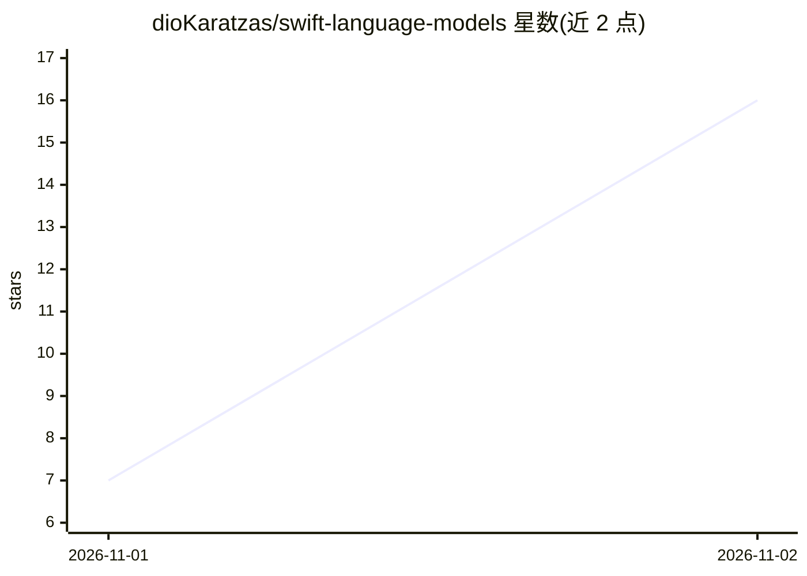

# dioKaratzas/swift-language-models

⭐ 16 · Swift · Apache-2.0 · 推送 2026-11-01 · [GitHub](https://github.com/dioKaratzas/swift-language-models) · [官网](https://swiftpackageindex.com/dioKaratzas/swift-language-models) · 个人维护

**Swift 库：用 Apple Foundation Models 会话接口接入 OpenRouter 等云端模型**

面向 Apple 平台开发者的 Swift 包，为第三方语言模型服务提供 Foundation Models `LanguageModelSession` 协议的一致性实现：应用保留 `import FoundationModels` 与 Apple 自带的会话、transcript、工具、@Generable 引导生成、Dynamic Profiles 与 reasoning levels，通过 provider 模块把远端模型接入同一会话，切换仅改 `model:`。核心模块含 DetailedLanguageModel、类型化模型目录、推理力度与 FileAttachment；目前 OpenRouter 为首个 provider 模块，覆盖 Anthropic/OpenAI/Google/DeepSeek/Qwen/Meta/Mistral 等模型，支持 apiKey 闭包不落盘、fallback 路由、prompt 缓存标记、server tools（webSearch/webFetch/advisor/subagent）与类型化用量/成本元数据。限制：云端服务需 API key，模型目录不含价格。

## 筛选速览

| 维度 | 判定 | 备注 |
|---|---|---|
| AI 角色 | `ai-ecosystem` | LLM/agent 周边工具 |
| 许可风险 | `permissive` | Apache-2.0 |
| 部署形态 | `None` |  |
| 模型依赖 | locked-api |  |
| 硬件要求 | — | 无带数字的原话,不猜 |
| 安装摩擦 | `low` | 无编译、无系统依赖或容器化 |
| 成熟度 | — | 结构信号不足 |

## 能力要点

- 为 OpenRouter 等服务实现 Apple LanguageModelSession 协议一致性，同一会话切换本地/远端模型
- 类型化模型目录（上下文窗口、输出上限、能力、推理力度），由仓库内 bot 保持更新
- apiKey 以闭包按请求提供，密钥不存储不记录，支持自建 baseURL 转发
- 支持 fallbacks 路由、prompt 缓存标记、server tools（webSearch/webFetch/advisor/subagent）与成本/用量元数据

## 适用场景

- 在 iOS/macOS 应用中用 Foundation Models API 调用 OpenRouter 上的模型
- 一套会话代码在 Apple 端侧模型与云端模型之间切换
- 运行时从类型化目录中筛选（如支持视觉的）模型供用户选择

## 场景标签

`模型网关` · 领域:Agent 开发

## 证据(README 行号)

> L9: One Foundation Models API for every provider's language models. Apple's `LanguageModelSession`, with its transcripts
> L30: Foundation Models 27 lets any type conform to its `LanguageModel` protocol, as Apple's
> L37: The package has two kinds of module. `LanguageModels` is the core that every provider module shares:

## 星数曲线

2026-11-01 7 → 2026-11-02 16（+9）

---
*卡片 v1 · prompt 1.4 · 生成 2026-11-02 · 置信度 high · 依据 README sha `4136c6cecdd7` · [字段定义](../../DATASET.md)*
