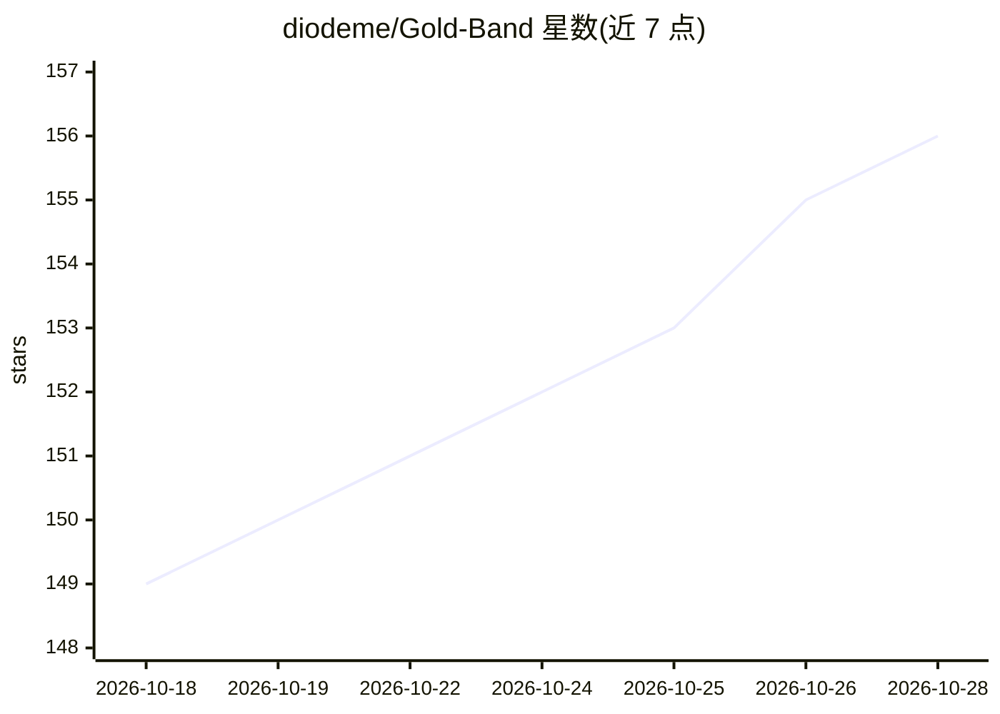

# diodeme/Gold-Band

⭐ 157 · Rust · AGPL-3.0 · 推送 2026-10-28 · [GitHub](https://github.com/diodeme/Gold-Band) · 个人维护 · 中文 README

**本地 AI Agent 桌面客户端：统一接入多种 Coding Agent 并编排工作流**

基于 Tauri 2 与 Rust 构建的桌面 AI Agent 客户端，通过 Agent Client Protocol (ACP) 接入 Claude Code、Codex、Cursor、Gemini CLI 等多种本地 Agent，提供统一的桌面交互界面。提供三种运行模式：DIRECT 直接对话、WORKFLOW 固定工作流、AUTO 编排模式（子任务拆分、独立 Git worktree 并行执行、合并与验收节点）。内置 MCP/SKILL/Profile 管理、定时任务、Git 源码控制、内置浏览器与 IM 远程干预。安装包数 MB 级，多会话并行时内存约 300 MB。macOS 版未签名公证，Linux 构建未完全测试。

## 筛选速览

| 维度 | 判定 | 备注 |
|---|---|---|
| AI 角色 | `ai-ecosystem` | LLM/agent 周边工具 |
| 许可风险 | `viral` | AGPL-3.0 |
| 部署形态 | `library` | 以包/库形式分发 |
| 模型依赖 | — | README 未给出锁定关系 |
| 硬件要求 | — | 无带数字的原话,不猜 |
| 安装摩擦 | `low` | 无编译、无系统依赖或容器化 |
| 成熟度 | `idea` | |

## 能力要点

- 通过 ACP 接入 11 种内置 Agent，支持自定义 ACP 兼容 Agent
- WORKFLOW 模式按节点配置 Agent/模型/角色/结果评估，可回溯修复重跑
- AUTO 模式：子任务拆分、独立 Git worktree 并行、合并与验收节点
- 安装包数 MB 级，多会话并行内存约 300 MB

## 适用场景

- 用一个桌面客户端管理多个本地 Coding Agent
- 长周期任务分离开发、审查、测试与验收环节
- 大型需求由 AUTO 模式拆分子任务并行推进并合并验收

## 场景标签

`编码 Agent` `Agent 框架` · 领域:Agent 开发

## 证据(README 行号)

> L20: Gold Band is a desktop AI Agent client for local projects. It connects to mainstream Agents such as Claude Code and
> L27: - **One client for mainstream Agents**: built-in support for Claude Code, Codex, Cursor, Gemini CLI, CodeBuddy, Goo
> L30: - **AUTO mode for large tasks**: a node splits the goal into subtasks and dispatches them; each subtask runs in its

## 星数曲线

2026-10-18 149 → 2026-10-28 156（+7）

---
*卡片 v1 · prompt 1.4 · 生成 2026-10-22 · 置信度 mid · 依据 README sha `2828667c7032` · [字段定义](../../DATASET.md)*
