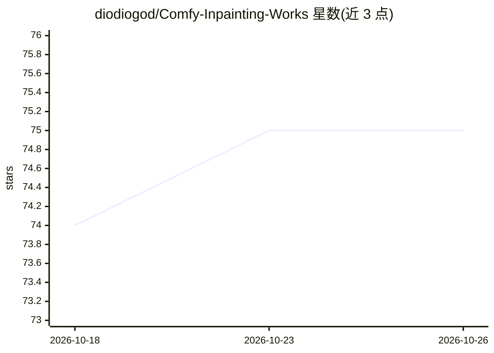

# diodiogod/Comfy-Inpainting-Works

⭐ 75 · Python · 推送 2025-11-04 · [GitHub](https://github.com/diodiogod/Comfy-Inpainting-Works) · 个人维护

**ComfyUI 用的 Flux 局部重绘/外绘工作流模板（Expanded/Compact 双版本）**

一套在 ComfyUI 中运行的 Flux 图像局部重绘与外绘工作流，以 custom node 形式发布，可通过 ComfyUI Manager 或 git clone 安装，安装后在模板浏览中加载。支持 Flux Dev（Alimama）、Flux Fill、Flux Kontext、Flux Tools LoRA（Depth/Canny）、ControlNet 集成、多种遮罩技术、批处理、LoRA 与提示词调度、循环、合成保真（避免 VAE 损伤原图像素、保持 8 整除尺寸）及元数据保存。提供界面精简的 Compact 版本，但其更新滞后且更难自定义。依赖大量第三方 custom nodes，ComfyUI 更新可能导致工作流失效。配有系列视频教程与 Discord 社区。

## 筛选速览

| 维度 | 判定 | 备注 |
|---|---|---|
| AI 角色 | `ai-native` | 本体是模型或模型工具 |
| 许可风险 | `none` | — |
| 部署形态 | `None` |  |
| 模型依赖 | — | README 未给出锁定关系 |
| 硬件要求 | — | 无带数字的原话,不猜 |
| 安装摩擦 | `low` | 无编译、无系统依赖或容器化 |
| 成熟度 | — | 结构信号不足 |

## 能力要点

- 合成时保护非重绘区域原始像素、图像保持 8 整除尺寸
- 支持 Flux Dev(Alimama)/Flux Fill/Flux Kontext/Flux Tools LoRA 与 ControlNet
- 遮罩扩展模糊、局部区域重绘、Daemon Detailer、Fast Fill、循环与调度等机制
- 以 custom node 形式通过 ComfyUI Manager 安装，随附 Expanded/Compact 两版工作流

## 适用场景

- 我在 ComfyUI 里对图片做高质量局部重绘或外扩绘
- 我需要批量处理并保留原图未重绘区域的画质
- 我想用 ControlNet/LoRA 调度精细控制重绘效果

## 场景标签

`图像生成` · 领域:内容生成

## 证据(README 行号)

> L76: Flux Dev with Alimama 🔷 Batches 🔷 Flux Fill 🔷 Flux Kontext ❗🔷 Flux Tool Loras: Depth or Canny 🔷 Mask grow with blur
> L114: $${\color{lightgreen}3)}$$ This workflow is now a "custom_node" and can be installed manually or through the Comfy

## 星数曲线

2026-10-18 74 → 2026-10-26 75（+1）

---
*卡片 v1 · prompt 1.4 · 生成 2026-10-24 · 置信度 high · 依据 README sha `a82a4a4079de` · [字段定义](../../DATASET.md)*
