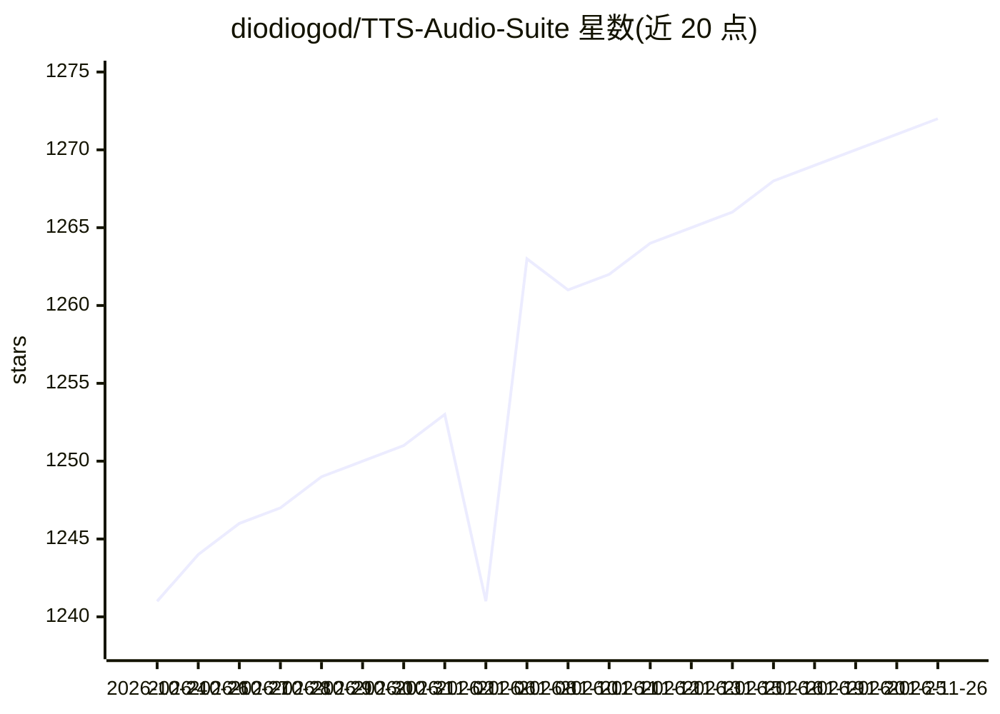

# diodiogod/TTS-Audio-Suite

⭐ 1,272 · Python · NOASSERTION · 推送 2026-11-24 · [GitHub](https://github.com/diodiogod/TTS-Audio-Suite) · 个人维护

**ComfyUI 多引擎本地 TTS/变声/字幕节点套件**

面向 ComfyUI 用户的通用多引擎语音扩展，从 ChatterBox Voice 项目演化而来。统一提供文本转语音、语音转换（RVC）、ASR 转写、音频编辑、SRT 字幕生成与对齐、RVC 模型训练等功能，集成 20 个引擎（ChatterBox、F5-TTS、Higgs Audio、IndexTTS、Qwen3-TTS、DramaBox、MOSS-TTS 等），含长文本切分、分段缓存、角色切换与逐段参数控制。架构采用 Transformers 5 主环境加旧栈隔离运行时；提供新增引擎的开发指南与 YouTube 演示视频。

## 筛选速览

| 维度 | 判定 | 备注 |
|---|---|---|
| AI 角色 | `ai-native` | 本体是模型或模型工具 |
| 许可风险 | `none` | NOASSERTION |
| 部署形态 | `desktop` | 安装包/桌面程序 |
| 模型依赖 | — | README 未给出锁定关系 |
| 硬件要求 | — | 无带数字的原话,不猜 |
| 安装摩擦 | `medium` | 含编译或系统依赖之一 |
| 成熟度 | — | 结构信号不足 |

## 能力要点

- 统一接入 20 个 TTS/语音转换/ASR 引擎，含多语言矩阵与特性对比表
- SRT 字幕工作流：转写、从编辑稿重建字幕、按可读性规则估算时间轴
- RVC 模型训练工作流集成，运行时隔离旧版引擎依赖
- Voice Designer 复用音色、逐段参数切换与智能文本切分

## 适用场景

- 在 ComfyUI 中生成多语言配音并与字幕时间轴对齐
- 用参考音频克隆音色或进行实时语音转换
- 为无声视频生成基础 SRT 时间模板后手动补词
- 本地训练 RVC 语音转换模型

## 场景标签

`语音合成` `语音识别` `模型训练` · 领域:内容生成

## 证据(README 行号)

> L15: A comprehensive ComfyUI extension providing unified Text-to-Speech, Voice Conversion, Audio Editing, and integrated
> L83: - 🎤 **Multi-Engine TTS**
> L87: - ✏️ **ASR Transcription**

## 星数曲线

2026-10-24 1,241 → 2026-11-26 1,272（+31）

---
*卡片 v1 · prompt 1.4 · 生成 2026-11-26 · 置信度 mid · 依据 README sha `c95cfb539aac` · [字段定义](../../DATASET.md)*
