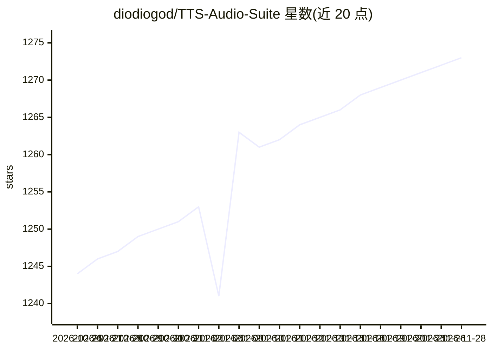

# diodiogod/TTS-Audio-Suite

⭐ 1,273 · Python · NOASSERTION · 推送 2026-11-27 · [GitHub](https://github.com/diodiogod/TTS-Audio-Suite) · 个人维护

**ComfyUI 多引擎本地 TTS 与语音转换节点套件**

作为 ComfyUI 自定义节点扩展，统一接入 20 个本地 TTS/语音转换/ASR 引擎（含 ChatterBox、F5-TTS、Higgs Audio 2/v3、IndexTTS-2、CosyVoice3、Qwen3-TTS、RVC 等），提供文本转语音、语音转换、RVC 模型训练、SRT 字幕对齐生成、音频后期处理与静默视频口型分析。架构上采用 Transformers 5 主环境加共享旧版运行时的隔离机制，以兼容依赖较旧栈的引擎。需在 ComfyUI 环境中运行。

## 筛选速览

| 维度 | 判定 | 备注 |
|---|---|---|
| AI 角色 | `ai-native` | 本体是模型或模型工具 |
| 许可风险 | `none` | NOASSERTION |
| 部署形态 | `desktop` | 安装包/桌面程序 |
| 模型依赖 | — | README 未给出锁定关系 |
| 硬件要求 | `gpu-24g` | |
| 安装摩擦 | `medium` | 含编译或系统依赖之一 |
| 成熟度 | — | 结构信号不足 |

## 能力要点

- 统一节点接入 20 个 TTS/VC/ASR 引擎，含引擎对比表（语言、模型大小、特性）
- SRT 字幕工作流：转写为 SRT、从编辑文本重建字幕、分段级缓存只重生成修改段
- RVC 实时语音转换与集成模型训练工作流
- 运行时隔离机制：旧栈引擎用共享 legacy runtime，主环境运行 Transformers 5

## 适用场景

- 在 ComfyUI 工作流里为视频生成分角色、按时长的配音
- 从静默视频生成基础 SRT 时间轴再手动编辑字幕
- 用参考音频克隆声音并进行多说话人对话生成
- 为 SRT 字幕文件生成精确对齐的 TTS 音频

## 场景标签

`语音合成` `语音识别` `模型训练` · 领域:内容生成

## 证据(README 行号)

> L11: *Universal multi-engine TTS extension for ComfyUI - evolved from the original ChatterBox Voice project.*
> L15: A comprehensive ComfyUI extension providing unified Text-to-Speech, Voice Conversion, Audio Editing, and integrated
> L83: - 🎤 **Multi-Engine TTS**

## 星数曲线

2026-10-26 1,244 → 2026-11-28 1,273（+29）

---
*卡片 v1 · prompt 1.4 · 生成 2026-11-28 · 置信度 high · 依据 README sha `0754edbd5105` · [字段定义](../../DATASET.md)*
