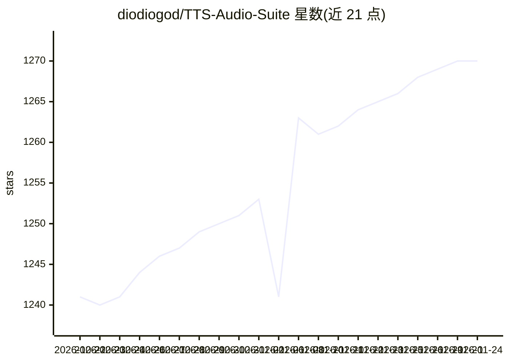

# diodiogod/TTS-Audio-Suite

⭐ 1,271 · Python · NOASSERTION · 推送 2026-11-19 · [GitHub](https://github.com/diodiogod/TTS-Audio-Suite) · 个人维护

**给 ComfyUI 用户提供多引擎本地 TTS 与语音转换节点**

一个 ComfyUI 自定义节点扩展，通过统一接口接入 20 个 TTS/ASR/语音转换引擎（ChatterBox、F5-TTS、Higgs Audio、VibeVoice、IndexTTS、RVC 等），提供文本转语音、语音克隆、声音转换、ASR 转写、SRT 字幕同步生成、音频后处理与 RVC 模型训练工作流。采用模块化架构，新版对脆弱旧引擎提供运行时隔离，主环境运行在 Transformers 5。SRT 节点支持分段缓存，仅重新生成修改过的片段。

## 筛选速览

| 维度 | 判定 | 备注 |
|---|---|---|
| AI 角色 | `ai-native` | 本体是模型或模型工具 |
| 许可风险 | `none` | NOASSERTION |
| 部署形态 | `desktop` | 安装包/桌面程序 |
| 模型依赖 | — | README 未给出锁定关系 |
| 硬件要求 | `gpu-24g` | |
| 安装摩擦 | `medium` | 含编译或系统依赖之一 |
| 成熟度 | — | 结构信号不足 |

## 能力要点

- 统一接入 20 个 TTS/语音转换引擎，含语言与显存对比表
- SRT 字幕工作流：转写生成 SRT、按编辑稿重建字幕、分段缓存
- 集成 RVC 模型训练工作流与语音设计器
- 运行时隔离架构：主环境 Transformers 5，脆弱引擎用共享旧版运行时

## 适用场景

- 在 ComfyUI 里用多引擎生成配音和克隆声音
- 为视频生成与字幕时间轴同步的 TTS 音频
- 从静音视频自动生成基础字幕时间模板
- 训练 RVC 声音转换模型

## 场景标签

`语音合成` `语音识别` `模型训练` · 领域:内容生成

## 证据(README 行号)

> L11: *Universal multi-engine TTS extension for ComfyUI - evolved from the original ChatterBox Voice project.*
> L15: A comprehensive ComfyUI extension providing unified Text-to-Speech, Voice Conversion, Audio Editing, and integrated
> L83: - 🎤 **Multi-Engine TTS**

## 星数曲线

2026-10-22 1,241 → 2026-11-24 1,270（+29）

---
*卡片 v1 · prompt 1.4 · 生成 2026-11-23 · 置信度 high · 依据 README sha `3de61081dd0a` · [字段定义](../../DATASET.md)*
