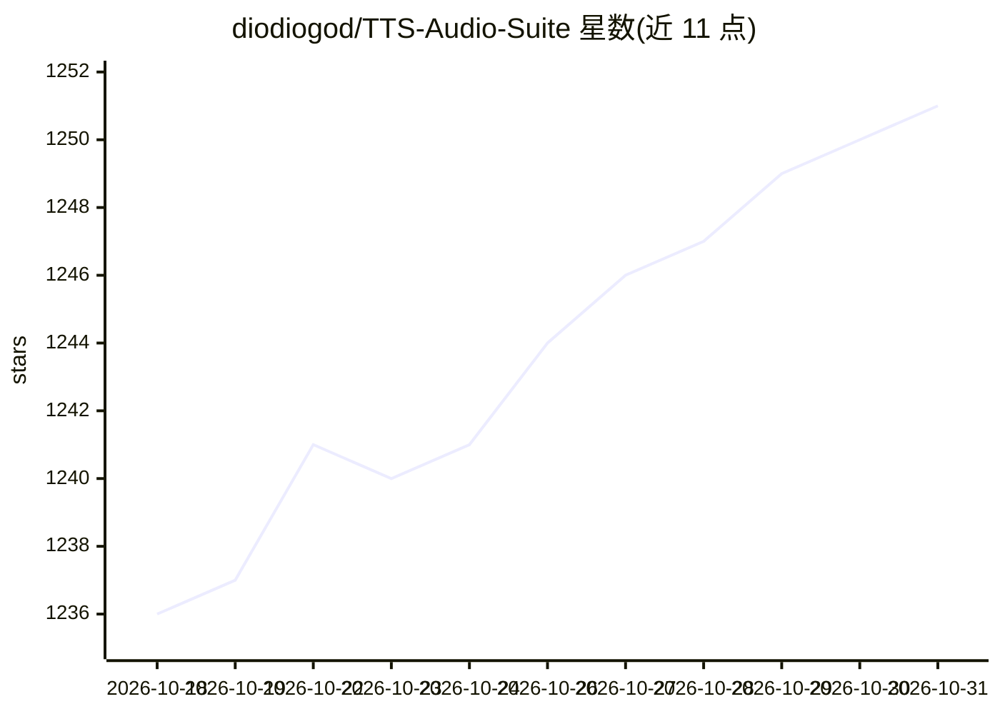

# diodiogod/TTS-Audio-Suite

⭐ 1,251 · Python · NOASSERTION · 推送 2026-10-24 · [GitHub](https://github.com/diodiogod/TTS-Audio-Suite) · 个人维护

**ComfyUI 多引擎本地 TTS 与语音转换节点套件**

ComfyUI 自定义节点扩展，统一集成 19 个 TTS/语音转换/ASR 引擎（F5-TTS、Chatterbox、Qwen3-TTS、CosyVoice3、IndexTTS-2、Higgs Audio、RVC 等），提供多引擎 TTS、声音设计、声音转换、ASR 转写、Text-to-SRT 构建、集成 RVC 模型训练与音频后处理。核心场景为字幕工作流：从 SRT 生成对齐语音、重建字幕时间轴。架构上主环境运行于 Transformers 5，为旧栈引擎提供运行时隔离。面向使用 ComfyUI 的内容创作者，通过源码或 ComfyUI-Manager 安装。

## 筛选速览

| 维度 | 判定 | 备注 |
|---|---|---|
| AI 角色 | `ai-native` | 本体是模型或模型工具 |
| 许可风险 | `none` | NOASSERTION |
| 部署形态 | `desktop` | 安装包/桌面程序 |
| 模型依赖 | — | README 未给出锁定关系 |
| 硬件要求 | `gpu-24g` | |
| 安装摩擦 | `medium` | 含编译或系统依赖之一 |
| 成熟度 | `idea` | |

## 能力要点

- 19 个引擎的统一 TTS/VC/ASR 节点（F5-TTS、Chatterbox、Qwen3-TTS、RVC 等）
- SRT 字幕工作流：SRT 生成 TTS、智能时间轴、分段级缓存
- 静音视频口型分析（MediaPipe）生成基础 SRT 时间模板
- Transformers 5 主环境 + 脆弱引擎运行时隔离架构

## 适用场景

- 在 ComfyUI 中用多个本地 TTS 引擎为视频/动画配音
- 基于 SRT 字幕生成时间对齐的语音
- 用 RVC 做实时语音转换并训练自定义模型
- 从静音视频的口型运动生成字幕时间草稿

## 场景标签

`语音合成` `语音识别` `图像视频处理` · 领域:内容生成

## 证据(README 行号)

> L15: A comprehensive ComfyUI extension providing unified Text-to-Speech, Voice Conversion, Audio Editing, and integrated
> L82: - 🎤 **Multi-Engine TTS**

## 星数曲线

2026-10-18 1,236 → 2026-10-31 1,251（+15）

---
*卡片 v1 · prompt 1.4 · 生成 2026-10-21 · 置信度 mid · 依据 README sha `d0b4ca9fe027` · [字段定义](../../DATASET.md)*
