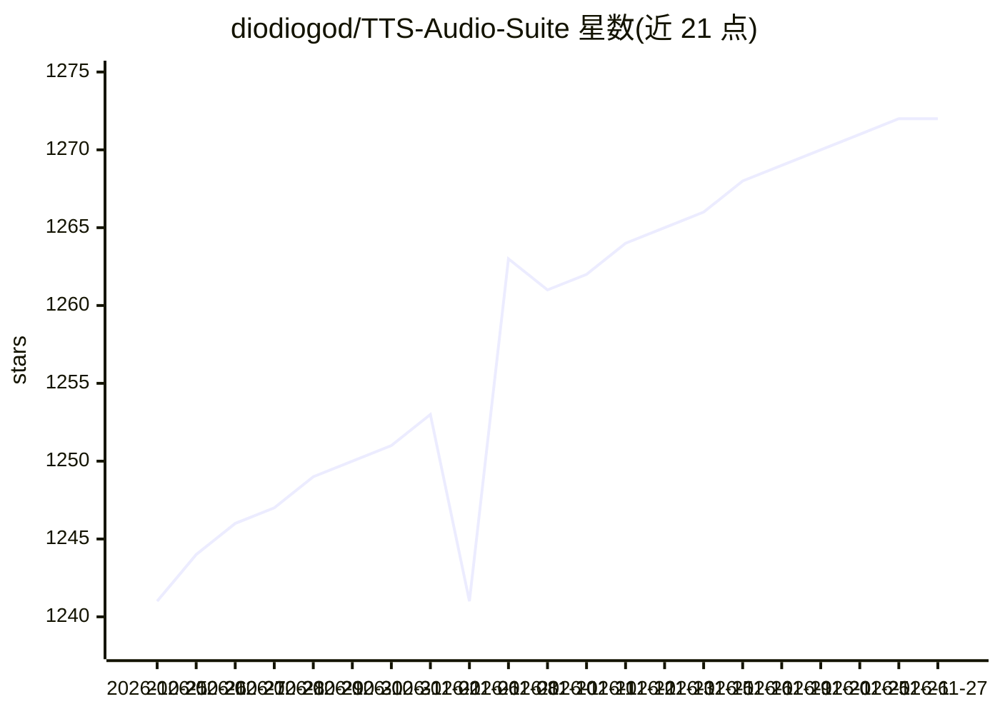

# diodiogod/TTS-Audio-Suite

⭐ 1,272 · Python · NOASSERTION · 推送 2026-11-26 · [GitHub](https://github.com/diodiogod/TTS-Audio-Suite) · 个人维护

**ComfyUI 多引擎本地 TTS/语音转换节点套件**

面向 ComfyUI 用户的统一语音扩展节点：聚合 20 个引擎（F5-TTS、ChatterBox、Higgs Audio、IndexTTS、CosyVoice3、Qwen3-TTS、RVC 等），提供文本转语音、语音转换、ASR 转写、SRT 字幕同步生成、声音设计、RVC 模型训练与音频后处理节点。采用模块化架构，主环境运行 Transformers 5，脆弱引擎走隔离运行时。各引擎按语言与体积给出对照表，部分引擎显存需求较高（如 DramaBox fast 模式约 24GB VRAM）。

## 筛选速览

| 维度 | 判定 | 备注 |
|---|---|---|
| AI 角色 | `ai-native` | 本体是模型或模型工具 |
| 许可风险 | `none` | NOASSERTION |
| 部署形态 | `desktop` | 安装包/桌面程序 |
| 模型依赖 | — | README 未给出锁定关系 |
| 硬件要求 | — | 无带数字的原话,不猜 |
| 安装摩擦 | `medium` | 含编译或系统依赖之一 |
| 成熟度 | — | 结构信号不足 |

## 能力要点

- 聚合 20 个 TTS/VC/ASR 引擎的统一节点接口
- SRT 字幕工作流：按字幕时间轴生成、分段缓存、静默视频口型分析建轴
- 集成 RVC 训练工作流与统一 LoRA 训练节点
- 运行时隔离架构：主环境 Transformers 5，遗留引擎共享隔离运行时

## 适用场景

- 在 ComfyUI 中按字幕时间轴批量生成配音
- 用参考音频做声音克隆或语音转换
- 为多角色多语言对话生成语音并切换角色
- 从静默视频生成基础字幕时间轴再人工编辑

## 场景标签

`语音合成` `语音识别` `微调` · 领域:内容生成

## 证据(README 行号)

> L15: A comprehensive ComfyUI extension providing unified Text-to-Speech, Voice Conversion, Audio Editing, and integrated
> L19: ## Quick Engine Comparison — 20 Engines
> L83: - 🎤 **Multi-Engine TTS**

## 星数曲线

2026-10-25 1,241 → 2026-11-27 1,272（+31）

---
*卡片 v1 · prompt 1.4 · 生成 2026-11-27 · 置信度 low · 依据 README sha `7d2bf5fb3ba1` · [字段定义](../../DATASET.md)*
