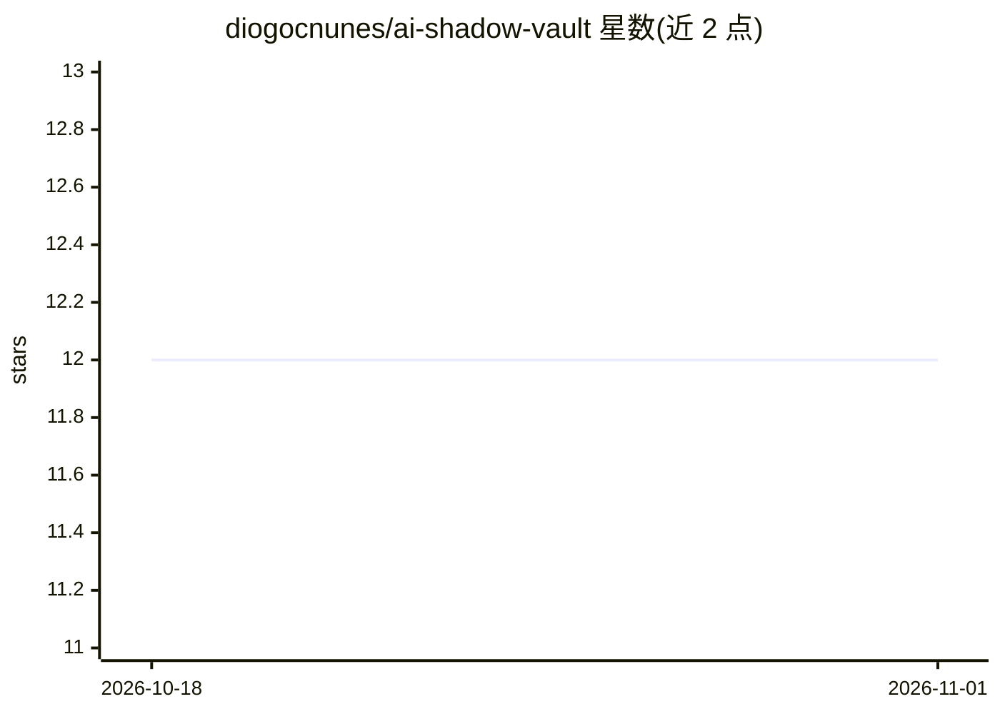

# diogocnunes/ai-shadow-vault

⭐ 12 · Shell · MIT · 推送 2026-06-29 · [GitHub](https://github.com/diogocnunes/ai-shadow-vault) · 个人维护

**让 CLAUDE.md/AGENTS.md 等 AI 适配文件不入 Git 的 CLI 工具**

面向团队与独立开发者的 shell 工具：把 CLAUDE.md、AGENTS.md、GEMINI.md 等适配文件存放在仓库外的机器级 vault，通过 ai-vault install/init/update 命令以符号链接方式挂入各项目，并用 .git/info/exclude（不改动 .gitignore）保持仓库干净。适配文件由统一内部指令模型渲染，可依据 composer.json/package.json 等清单生成 Stack Snapshot。项目身份基于仓库根路径的 sha1 前 8 位，在 Git worktrees 间保持稳定。Homebrew 为主要安装途径。

## 筛选速览

| 维度 | 判定 | 备注 |
|---|---|---|
| AI 角色 | `ai-ecosystem` | LLM/agent 周边工具 |
| 许可风险 | `permissive` | MIT |
| 部署形态 | `None` |  |
| 模型依赖 | — | README 未给出锁定关系 |
| 硬件要求 | — | 无带数字的原话,不猜 |
| 安装摩擦 | `low` | 无编译、无系统依赖或容器化 |
| 成熟度 | — | 结构信号不足 |

## 能力要点

- 适配文件存于仓库外 vault，以符号链接挂入项目
- 仅管理 .git/info/exclude，从不修改 .gitignore
- 基于仓库清单（composer.json/package.json）生成 Stack Snapshot
- 跨 Git worktrees 的稳定项目身份（sha1 前 8 位）

## 适用场景

- 多个项目共用 CLAUDE.md/AGENTS.md 而不提交进仓库
- Git worktrees 间共享同一套 AI 适配配置
- 让生成的适配文件包含项目技术栈快照

## 场景标签

 · 领域:开发者工具

## 证据(README 行号)

> L5: AI Shadow Vault is a shell-first tool for teams and solo developers who want `CLAUDE.md`, `AGENTS.md`, and `GEMINI.m
> L132: `AGENTS.md` is rendered as the canonical entrypoint; `CLAUDE.md` and `GEMINI.md` are thin provider adapters.
> L276: - a machine-level adapter manager

## 星数曲线

2026-10-18 12 → 2026-11-01 12（+0）

---
*卡片 v1 · prompt 1.4 · 生成 2026-11-01 · 置信度 high · 依据 README sha `ee05da3dfd1b` · [字段定义](../../DATASET.md)*
