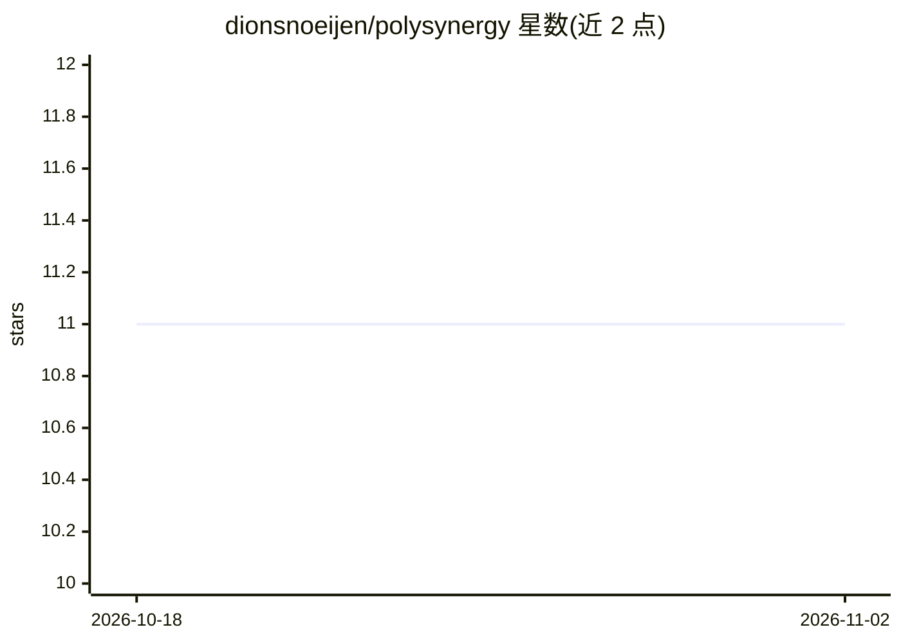

# dionsnoeijen/polysynergy

⭐ 11 · HCL · NOASSERTION · 推送 2026-04-18 · [GitHub](https://github.com/dionsnoeijen/polysynergy) · [官网](https://www.polysynergy.com) · 个人维护

**面向开发者的可视化 AI 工作流编排平台，可完全自托管**

开源的可视化工作流构建器：通过拖拽界面编排 AI agent 与各类集成，提供 40+ 节点类型（AI agent、数据处理、HTTP/邮件/AWS 集成、控制流、自定义 Python 节点），支持 OpenAI、Anthropic、Mistral、Ollama 等模型提供方。强调执行透明：WebSocket 实时监控、逐步可视化与日志追踪。以 Docker Compose 自托管运行（PostgreSQL、Redis、DynamoDB Local、MinIO），可选叠加 Ollama 实现完全本地 AI；也可部署到 AWS Lambda。项目自述处于 alpha 阶段，采用 BSL 1.1 许可。

## 筛选速览

| 维度 | 判定 | 备注 |
|---|---|---|
| AI 角色 | `ai-ecosystem` | LLM/agent 周边工具 |
| 许可风险 | `none` | NOASSERTION |
| 部署形态 | `self-host` | docker 或自建部署 |
| 模型依赖 | local-ok | 支持本地模型 |
| 硬件要求 | — | 无带数字的原话,不猜 |
| 安装摩擦 | `low` | 无编译、无系统依赖或容器化 |
| 成熟度 | `idea` | |

## 能力要点

- 拖拽式可视化编辑器，40+ 节点类型含 AI agent 与自定义 Python 节点
- WebSocket 实时执行监控与逐步调试
- Docker Compose 全自托管栈，可叠加 Ollama 实现完全本地 AI
- REST API 与 WebSocket 编程接口

## 适用场景

- 构建需要逐步可调试的多 agent 工作流
- 在自有基础设施上运行 AI 自动化流程而不依赖云服务
- 通过自定义 Python 节点扩展节点能力

## 场景标签

`工作流自动化` `Agent 框架` · 领域:Agent 开发

## 证据(README 行号)

> L3:  Open-source visual AI workflow builder for developers who need transparency and control
> L13: PolySynergy is a **visual workflow builder** that lets you orchestrate AI agents and integrations through a drag-an
> L19: - **Flexible AI provider** support (OpenAI, Anthropic, Mistral, Ollama)

## 星数曲线

2026-10-18 11 → 2026-11-02 11（+0）

---
*卡片 v1 · prompt 1.4 · 生成 2026-11-02 · 置信度 high · 依据 README sha `03489a60d8f5` · [字段定义](../../DATASET.md)*
