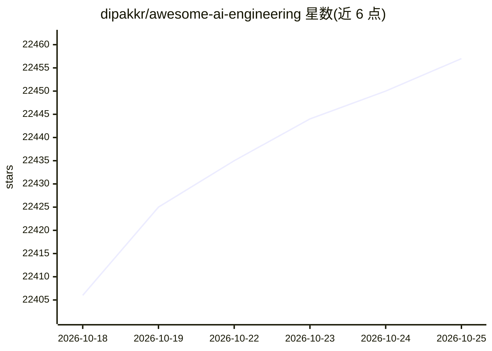

# dipakkr/awesome-ai-engineering

⭐ 22,465 · MIT · 推送 2026-10-21 · [GitHub](https://github.com/dipakkr/awesome-ai-engineering) · 个人维护

**面向学生与新手的 AI/编程学习资源聚合清单**

以课程、教程、GitHub 仓库、研究论文入口、认证与竞赛机会为主的资源目录，覆盖 AI 工具、Python、机器学习、LLM、深度学习，并延伸至 Web3、网络安全、云计算与前端等方向；用 :baby: 标注零基础内容、:heavy_dollar_sign: 标注付费内容、:star: 标注普遍推荐项。仓库本体不包含可安装的软件，内容以外部链接聚合形式提供。

## 筛选速览

| 维度 | 判定 | 备注 |
|---|---|---|
| AI 角色 | `ai-knowledge` | 知识聚合/清单类 |
| 许可风险 | `permissive` | MIT |
| 部署形态 | `None` |  |
| 模型依赖 | — | README 未给出锁定关系 |
| 硬件要求 | — | 无带数字的原话,不猜 |
| 安装摩擦 | `low` | 无编译、无系统依赖或容器化 |
| 成熟度 | — | 结构信号不足 |

## 动量与使用信号

- 维护:`maintenance` — 距上次 push 122.8 天,年发版 0,447 位贡献者
- 涨星:近 1 天 **+9**(自 20261016 起算)
- 安装:github 包 `release-assets` 月下载无数据

## 能力要点

- LLM 板块列出课程、论文入口与在线 Playground（OpenAI Playground、Google AI Studio、OpenRouter 等）
- 以 emoji 标记零基础/推荐/付费属性，附 Quick Start 路径
- 覆盖 ML/LLM/深度学习之外的多技术方向学习入口
- 汇总 hackathon、开源、面试准备等学生机会类资源

## 适用场景

- 我是零基础学生，想按路径找 AI/ML 入门课程
- 我想找 LLM 相关的公开课和论文检索入口
- 我想查 AI 常用工具和在线 Playground 的清单

## 场景标签

`精选清单` · 领域:学习与行业

## 证据(README 行号)

> L20: AI Tools and Resources
> L58: # AI Tools and Resources
> L176: ## Large Language Models (LLMs)

## 星数曲线

2026-10-18 22,406 → 2026-10-25 22,457（+51）

---
*卡片 v1 · prompt 1.4 · 生成 2026-10-18 · 置信度 high · 依据 README sha `fcbbd74a0a1c` · [字段定义](../../DATASET.md)*
