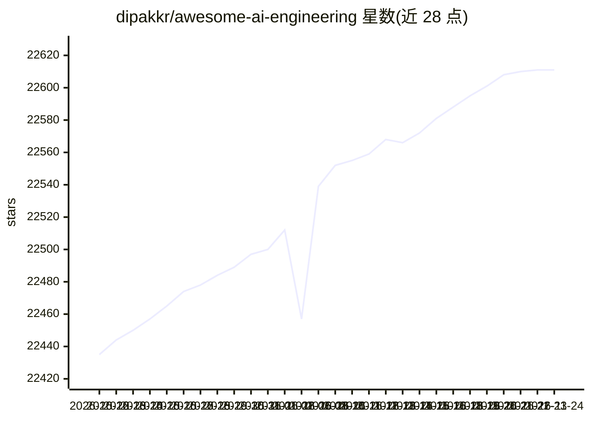

# dipakkr/awesome-ai-engineering

⭐ 22,611 · MIT · 推送 2026-10-21 · [GitHub](https://github.com/dipakkr/awesome-ai-engineering) · 个人维护

**面向学生与初级开发者的 AI/编程学习资源清单**

一份面向学生、应届毕业生与初级开发者的资源聚合清单（awesome list），覆盖编程语言入门、机器学习与大语言模型课程、研究论文入口、数据集平台、深度学习认证，并延伸至 Web3、网络安全、云计算与前端等技术方向。条目以初学者标记、推荐标记与付费标记区分难度与成本，并提供快速入门导览和分类目录，本身不含代码，仅为链接汇编。

## 筛选速览

| 维度 | 判定 | 备注 |
|---|---|---|
| AI 角色 | `ai-knowledge` | 知识聚合/清单类 |
| 许可风险 | `permissive` | MIT |
| 部署形态 | `None` |  |
| 模型依赖 | — | README 未给出锁定关系 |
| 硬件要求 | — | 无带数字的原话,不猜 |
| 安装摩擦 | `low` | 无编译、无系统依赖或容器化 |
| 成熟度 | — | 结构信号不足 |

## 动量与使用信号

- 维护:`maintenance` — 距上次 push 122.8 天,年发版 0,447 位贡献者
- 涨星:近 1 天 **+9**(自 20261016 起算)
- 安装:github 包 `release-assets` 月下载无数据

## 能力要点

- 按主题分类的课程/论文/数据集/仓库链接汇编，含 Python、ML、LLM、深度学习等板块
- 条目带 :baby:（零基础）、:star:（通用推荐）、付费 标记体系
- LLM 板块列出课程、论文来源与可测试模型的 Playground（OpenAI/Anthropic/OpenRouter 等）
- 另有 Web3、网络安全、DevOps、前端等非 AI 技术方向资源

## 适用场景

- 想系统学习 Python 或机器学习课程
- 查找大语言模型方向的在线课程与论文入口
- 了解 AI 工具与数据集平台
- 规划从零基础到 AI 工程的学习路径

## 场景标签

`精选清单` · 领域:学习与行业

## 证据(README 行号)

> L18: AI Tools and Resources
> L56: # AI Tools and Resources
> L130: # AI & Machine Learning

## 星数曲线

2026-10-22 22,435 → 2026-11-24 22,611（+176）

---
*卡片 v1 · prompt 1.4 · 生成 2026-11-22 · 置信度 high · 依据 README sha `9c8db90442a4` · [字段定义](../../DATASET.md)*
