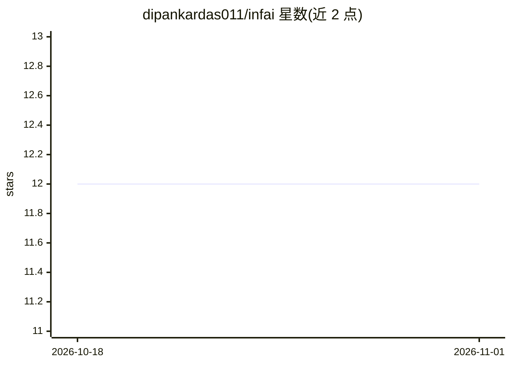

# dipankardas011/infai

⭐ 12 · Go · Apache-2.0 · 推送 2026-10-29 · [GitHub](https://github.com/dipankardas011/infai) · [官网](https://infai.dipankar-das.com/) · 个人维护

**本地 AI 终端工具集：TUI 管理 llama.cpp/vLLM 推理与后台 agent 服务**

同仓库提供两个 Go 单二进制工具。infai 是本地推理控制平面：以 profile（模型+引擎+配置）统一 llama.cpp 与 vLLM 的启动参数，在一个 TUI 中运行多模型、实时查看 CPU/RAM/VRAM 遥测与 tokens/s，支持从 Hugging Face 搜索下载 GGUF 量化文件、硬件适配预估，数据存于单个 SQLite 文件。infaiw 是 agent harness：以后台服务运行 agent 会话，含 sidecar 子代理循环、可分支事件时间线、会话间消息、MCP、human-in-the-loop 审批，接入 DeepSeek/OpenAI Codex/Claude Code。提供 brew 与 Linux 包安装，macOS/Linux 平台。

## 筛选速览

| 维度 | 判定 | 备注 |
|---|---|---|
| AI 角色 | `ai-ecosystem` | LLM/agent 周边工具 |
| 许可风险 | `permissive` | Apache-2.0 |
| 部署形态 | `None` |  |
| 模型依赖 | local-ok | 支持本地模型 |
| 硬件要求 | — | 无带数字的原话,不猜 |
| 安装摩擦 | `low` | 无编译、无系统依赖或容器化 |
| 成熟度 | — | 结构信号不足 |

## 能力要点

- profile 统一 llama.cpp 与 vLLM 的启动配置，一键运行多模型
- 实时系统与单模型 CPU/RAM/VRAM 遥测、tokens/s 与可复制日志
- Hugging Face 搜索下载 GGUF 量化、断点续传、硬件适配预估
- infaiw：durable 会话、sidecar 循环、MCP、等待用户的审批机制

## 适用场景

- 在终端统一启动和监控多个本地模型
- 从 Hugging Face 下载 GGUF 模型并预估本机能否运行
- 以后台服务运行 agent 会话并在审批点保留人工控制

## 场景标签

`编码 Agent` `推理引擎` · 领域:编码与开发

## 证据(README 行号)

> L16: |**infai** · engine|A control plane for local inference. Find or download a model, save a launch profile for llama.
> L17: |**infaiw** · workflows|An agent harness that works with you, not around you. It runs as a background service with 
> L57: llama.cpp or vLLM binary. In the **Models** tab, add a model folder and press `s` to

## 星数曲线

2026-10-18 12 → 2026-11-01 12（+0）

---
*卡片 v1 · prompt 1.4 · 生成 2026-11-01 · 置信度 high · 依据 README sha `de67c3f388da` · [字段定义](../../DATASET.md)*
