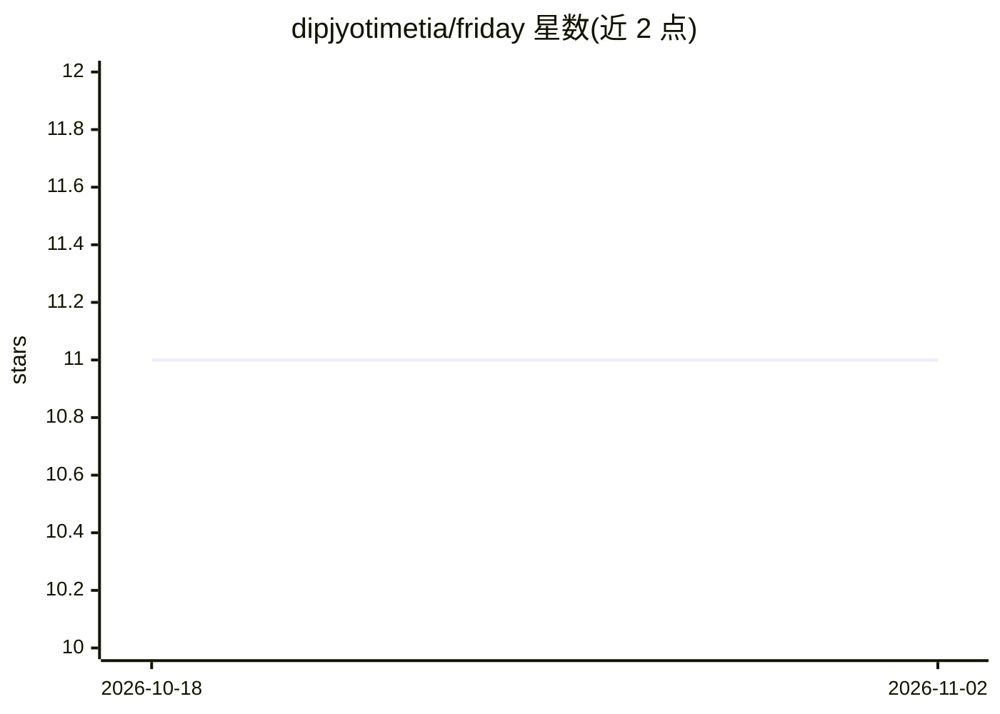

# dipjyotimetia/friday

⭐ 11 · Python · MIT · 推送 2025-11-10 · [GitHub](https://github.com/dipjyotimetia/friday) · 个人维护

**面向测试人员：从 Jira/GitHub issue 自动生成测试用例并执行 API 测试**

FRIDAY 是一个 AI 驱动的测试代理，使用 Google Gemini、OpenAI 或 Mistral 模型配合 LangChain，从 Jira 工单、GitHub issue 及 Confluence 页面提取需求并生成测试用例，可导出 JSON/Markdown；支持通过 Web 爬虫建立嵌入向量（ChromaDB 存储）补充上下文，并可基于 OpenAPI 规范执行 API 测试。以三种形式提供：React Web 应用（3000 端口）、CLI 命令行、FastAPI REST 服务（8080 端口）。项目标注 [WIP]，需要 Python 3.12+、uv 包管理器与模型 API key。

## 筛选速览

| 维度 | 判定 | 备注 |
|---|---|---|
| AI 角色 | `ai-native` | 本体是模型或模型工具 |
| 许可风险 | `permissive` | MIT |
| 部署形态 | `self-host` | docker 或自建部署 |
| 模型依赖 | — | README 未给出锁定关系 |
| 硬件要求 | — | 无带数字的原话,不猜 |
| 安装摩擦 | `low` | 无编译、无系统依赖或容器化 |
| 成熟度 | `idea` | |

## 能力要点

- 从 Jira/GitHub issue 提取需求并用 Gemini/OpenAI/Mistral 生成测试用例
- Confluence 上下文集成与 ChromaDB 向量化文档存储检索
- 基于 OpenAPI 规范执行 API 测试
- Web 应用 / CLI / REST API 三种使用形式

## 适用场景

- 从 Jira 工单或 GitHub issue 批量生成测试用例
- 结合 Confluence 文档上下文生成更贴合需求的用例
- 按 OpenAPI 规范自动执行 API 测试

## 场景标签

`代码生成` · 领域:编码与开发

## 证据(README 行号)

> L3: An AI-powered test agent that uses Generative AI and LangChain to automatically create test cases from Jira/GitHub i
> L15: - **AI-Powered Test Case Generation:** Leverage Google Gemini, OpenAI or mistral to generate test cases.

## 星数曲线

2026-10-18 11 → 2026-11-02 11（+0）

---
*卡片 v1 · prompt 1.4 · 生成 2026-11-02 · 置信度 mid · 依据 README sha `81ec7c6fda08` · [字段定义](../../DATASET.md)*
