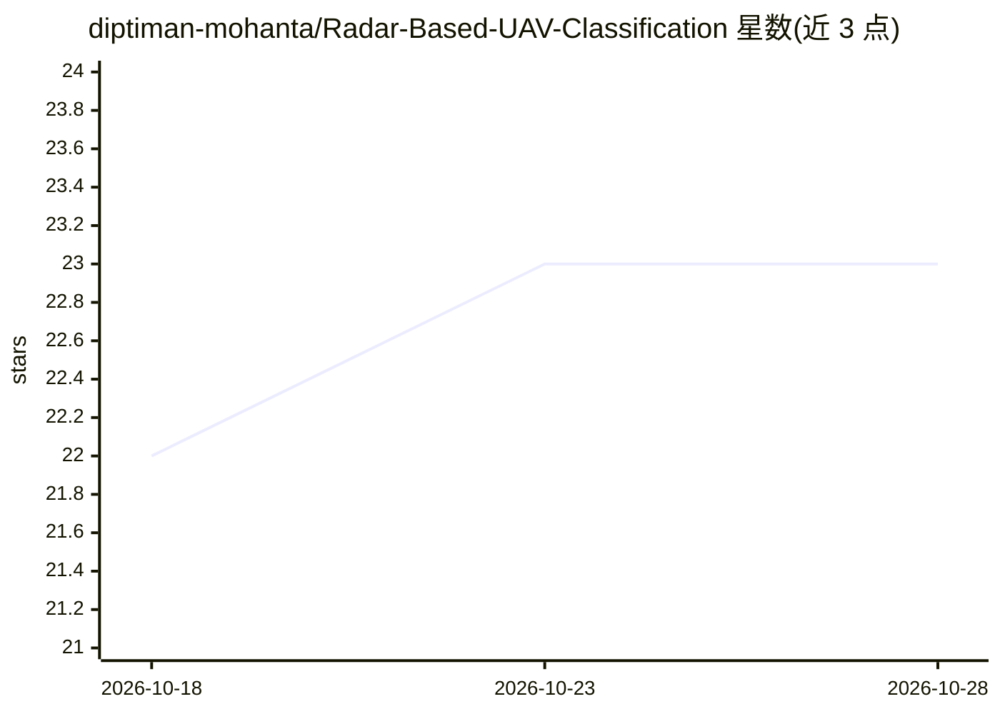

# diptiman-mohanta/Radar-Based-UAV-Classification

⭐ 23 · MATLAB · 推送 2026-06-02 · [GitHub](https://github.com/diptiman-mohanta/Radar-Based-UAV-Classification) · 组织维护

**雷达回波分类无人机/鸟类/遥控飞机的 MATLAB 深度学习系统**

基于 MATLAB 的雷达目标分类系统：对原始雷达回波做降采样、重采样与低通滤波预处理，经 SVMD（逐次变分模态分解）得到固有模态函数，再生成无交叉项的时频谱图，用预训练 SqueezeNet 提取深度特征，最终完成无人机、鸟类、遥控飞机及混合场景的多类识别。面向雷达信号处理与目标识别方向的科研用户。要求 MATLAB R2020b+ 及信号处理、深度学习、图像处理三个工具箱；数据集为 IEEE DataPort 的微多普勒数据集，需向作者邮件获取 .mat 文件。

## 筛选速览

| 维度 | 判定 | 备注 |
|---|---|---|
| AI 角色 | `ai-native` | 本体是模型或模型工具 |
| 许可风险 | `none` | — |
| 部署形态 | `None` |  |
| 模型依赖 | — | README 未给出锁定关系 |
| 硬件要求 | — | 无带数字的原话,不猜 |
| 安装摩擦 | `low` | 无编译、无系统依赖或容器化 |
| 成熟度 | — | 结构信号不足 |

## 能力要点

- SVMD 分解与无交叉项 STFT 谱图生成管道
- 预训练 SqueezeNet 迁移学习提取深度特征
- 四类目标识别：无人机、鸟类、遥控飞机、混合场景
- 端到端自动化流程：从原始雷达到分类结果

## 适用场景

- 对雷达微多普勒数据做无人机与鸟类区分研究
- 复现 SVMD+深度学习的雷达目标分类方法
- 作为雷达信号处理课程的参考实现

## 场景标签

`科研工具` · 领域:学习与行业

## 证据(README 行号)

> L32: Feature Extraction: Deep CNN features using SqueezeNet
> L34: Classification: Multi-class object identification

## 星数曲线

2026-10-18 22 → 2026-10-28 23（+1）

---
*卡片 v1 · prompt 1.4 · 生成 2026-10-27 · 置信度 high · 依据 README sha `54f9f2561866` · [字段定义](../../DATASET.md)*
