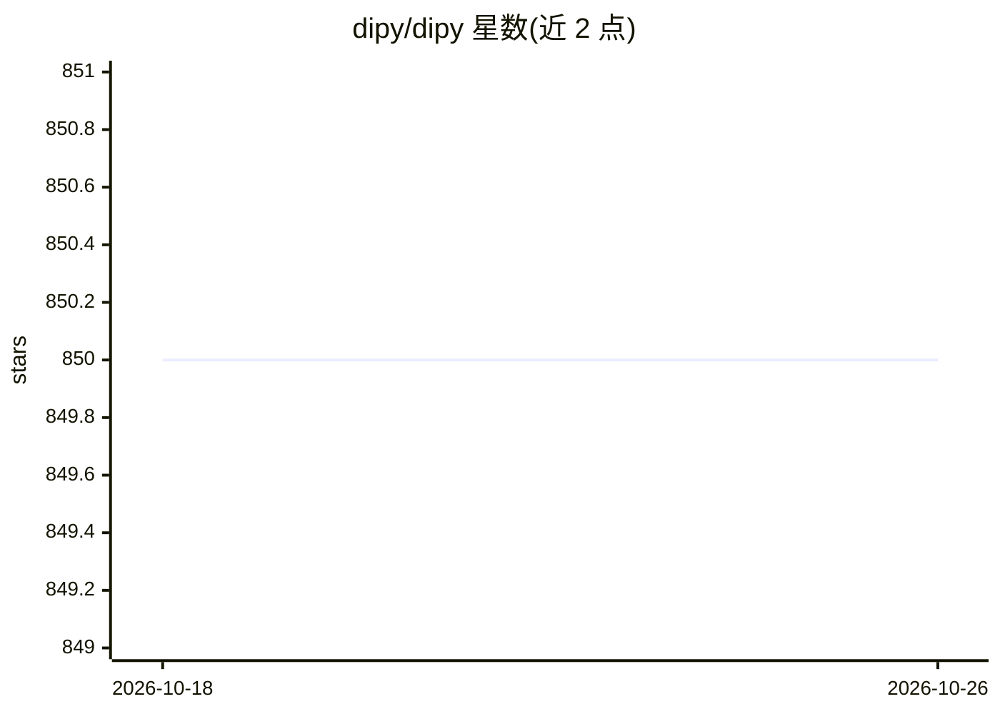

# dipy/dipy

⭐ 850 · Python · NOASSERTION · 推送 2026-10-22 · [GitHub](https://github.com/dipy/dipy) · [官网](https://dipy.org) · 组织维护

**Python 医学弥散 MRI 分析库，供科研图像处理**

DIPY 是用于 MR 弥散成像分析的 Python 库，提供空间归一化、信号处理、机器学习、统计分析与医学图像可视化等通用方法，并包含计算解剖学（弥散 MRI 重建、DTI/DKI、微结构、纤维束等）专门方法。面向科研用户，README 明确声明仅限研究用途，临床部署需联系维护方。支持 pip 与 conda 安装，遵循 BSD 3-Clause 许可与 Scientific Python SPEC 0 版本政策。

## 筛选速览

| 维度 | 判定 | 备注 |
|---|---|---|
| AI 角色 | `ai-native` | 本体是模型或模型工具 |
| 许可风险 | `permissive` | NOASSERTION |
| 部署形态 | `library` | 以包/库形式分发 |
| 模型依赖 | — | README 未给出锁定关系 |
| 硬件要求 | — | 无带数字的原话,不猜 |
| 安装摩擦 | `low` | 无编译、无系统依赖或容器化 |
| 成熟度 | — | 结构信号不足 |

## 能力要点

- 3D/4D+ 医学图像分析：去噪、弥散 MRI、DTI/DKI、微结构与神经解剖
- 提供空间归一化、信号处理、机器学习与可视化通用方法
- 支持 pip 与 conda-forge 安装
- 声明仅限研究用途，临床部署需联系维护方

## 适用场景

- 分析弥散 MRI 数据并重建脑纤维束
- 对医学图像做去噪与统计、机器学习分析
- 科研项目中做神经影像学方法开发与可视化

## 场景标签

`科研工具` `图像视频处理` · 领域:学习与行业

## 证据(README 行号)

> L29: DIPY [DIPYREF]_ is a python library for the analysis of MR diffusion imaging.
> L31: DIPY is for research only; please contact admins@dipy.org if you plan to deploy

## 星数曲线

2026-10-18 850 → 2026-10-26 850（+0）

---
*卡片 v1 · prompt 1.4 · 生成 2026-10-21 · 置信度 high · 依据 README sha `9e39d642550a` · [字段定义](../../DATASET.md)*
