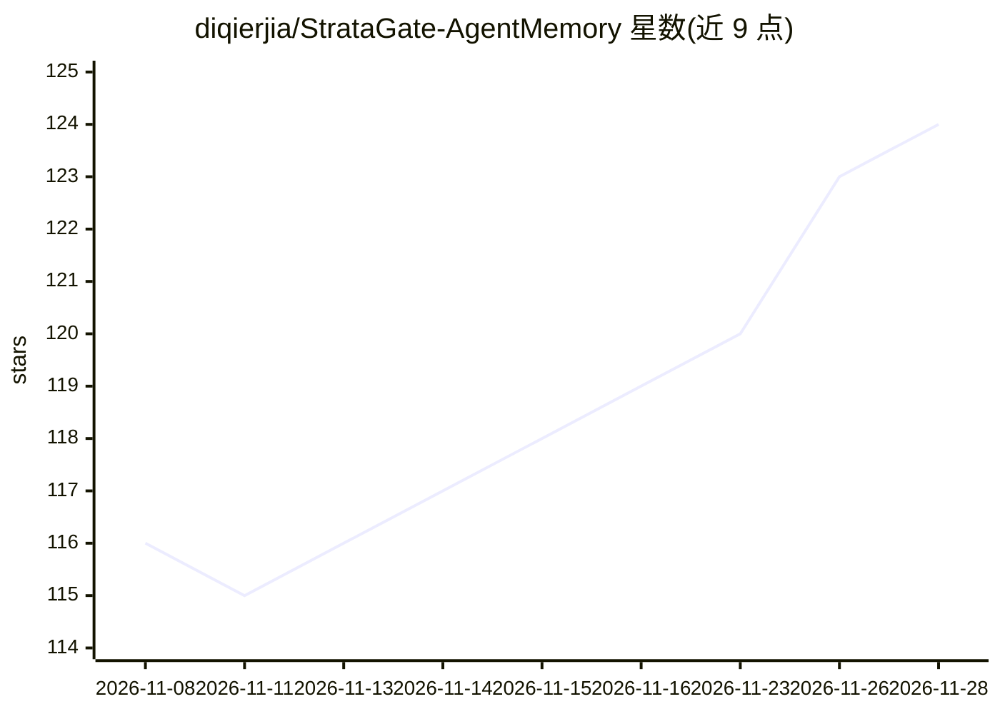

# diqierjia/StrataGate-AgentMemory

⭐ 124 · TypeScript · MIT · 推送 2026-11-27 · [GitHub](https://github.com/diqierjia/StrataGate-AgentMemory) · 个人维护 · 中文 README

**DeepSeek Harness 的跨会话分层记忆插件**

StrataGate 是 DeepSeek Harness（DSH）的跨会话记忆插件：对话按 Block 封存为 L0–L5 六级细节视图，旧历史默认精简、可展开恢复原文；每日笔记记录进展以便新会话续接工作；重要信息成为带时间、范围与来源引用的长期 Event，并由主题目录组织；可选启用知识图谱、嵌入模型语义检索与重排序。回答前设有证据门判断检索证据是否充分，仅实际使用的 Event 触发权重强化。通过 dsh plugin 命令或 npm 安装，本地优先存储。

## 筛选速览

| 维度 | 判定 | 备注 |
|---|---|---|
| AI 角色 | `ai-ecosystem` | LLM/agent 周边工具 |
| 许可风险 | `permissive` | MIT |
| 部署形态 | `library` | 以包/库形式分发 |
| 模型依赖 | locked-api |  |
| 硬件要求 | — | 无带数字的原话,不猜 |
| 安装摩擦 | `low` | 无编译、无系统依赖或容器化 |
| 成熟度 | — | 结构信号不足 |

## 能力要点

- L0–L5 六级对话记忆视图，旧记录精简且原文可恢复
- Event 长期记忆带来源引用，主题目录组织检索
- 证据门：回答前评估检索证据是否充分
- 检索命中不自动强化记忆，仅实际使用才更新权重

## 适用场景

- 跨会话续接此前的工作进度
- 让 agent 长期记住决策、偏好与项目事实并可溯源
- 控制历史对话占用的上下文长度

## 场景标签

`Agent 记忆` · 领域:Agent 开发

## 证据(README 行号)

> L9: StrataGate is a cross-session memory plugin for DeepSeek Harness. Daily notes help resume recent work, layered conve
> L67: ## Quick start: DeepSeek Harness

## 星数曲线

2026-11-08 116 → 2026-11-28 124（+8）

---
*卡片 v1 · prompt 1.4 · 生成 2026-11-17 · 置信度 mid · 依据 README sha `a60b983f915a` · [字段定义](../../DATASET.md)*
