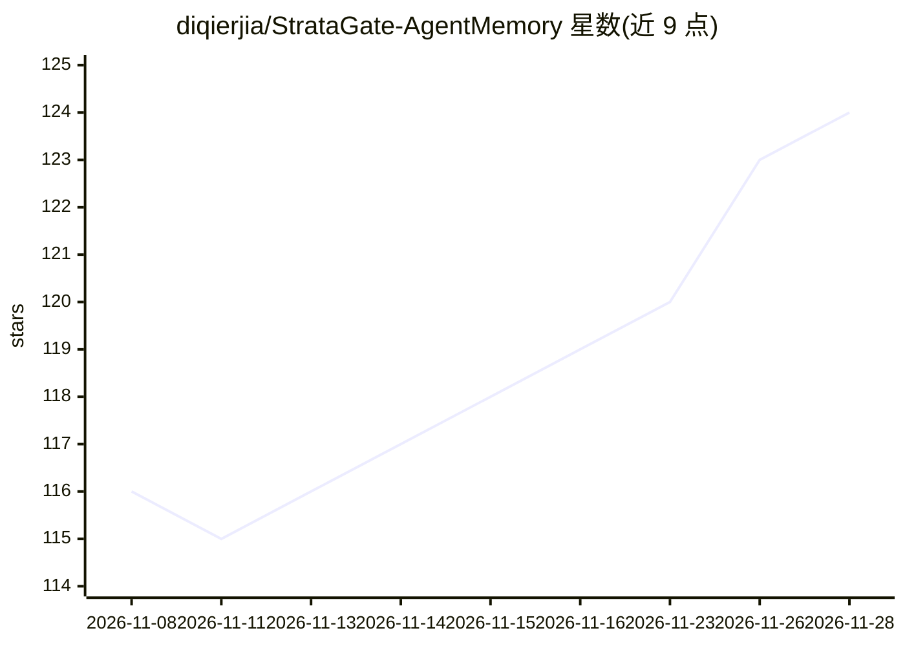

# diqierjia/StrataGate-AgentMemory

⭐ 124 · TypeScript · MIT · 推送 2026-11-27 · [GitHub](https://github.com/diqierjia/StrataGate-AgentMemory) · 个人维护 · 中文 README

**给 DeepSeek Harness agent 提供跨会话分层记忆的插件**

StrataGate 是面向 DeepSeek Harness 的跨会话记忆插件。它以日>Note 记录近期进展，将对话按 L0-L5 六级视图分层、旧对话逐步精简且原文可展开，把重要决策沉淀为带时间与来源的 Event，并通过主题目录、可选知识图谱、语义检索与重排支持按需查找。回答前设有证据门检查，检索命中不自动强化记忆，仅实际使用才更新权重。通过 dsh 命令安装，需重启 profile 生效。

## 筛选速览

| 维度 | 判定 | 备注 |
|---|---|---|
| AI 角色 | `ai-ecosystem` | LLM/agent 周边工具 |
| 许可风险 | `permissive` | MIT |
| 部署形态 | `library` | 以包/库形式分发 |
| 模型依赖 | locked-api |  |
| 硬件要求 | — | 无带数字的原话,不猜 |
| 安装摩擦 | `low` | 无编译、无系统依赖或容器化 |
| 成熟度 | — | 结构信号不足 |

## 能力要点

- 对话记忆按 L0-L5 六级视图存储，旧记录精简、原文可展开
- Event 记录重要决策并保留时间与来源引用
- 证据门机制：回答前评估检索证据是否充分
- 知识图谱与语义检索可选启用，默认关闭

## 适用场景

- 让 AI agent 跨会话记住项目进展并接续之前工作
- 回溯历史对话中某个决策的原始措辞与上下文
- 整理长期积累的偏好、决策与需求信息

## 场景标签

`Agent 记忆` · 领域:Agent 开发

## 证据(README 行号)

> L9: StrataGate is a cross-session memory plugin for DeepSeek Harness. Daily notes help resume recent work, layered conve
> L67: ## Quick start: DeepSeek Harness

## 星数曲线

2026-11-08 116 → 2026-11-28 124（+8）

---
*卡片 v1 · prompt 1.4 · 生成 2026-11-28 · 置信度 high · 依据 README sha `24046d197bac` · [字段定义](../../DATASET.md)*
