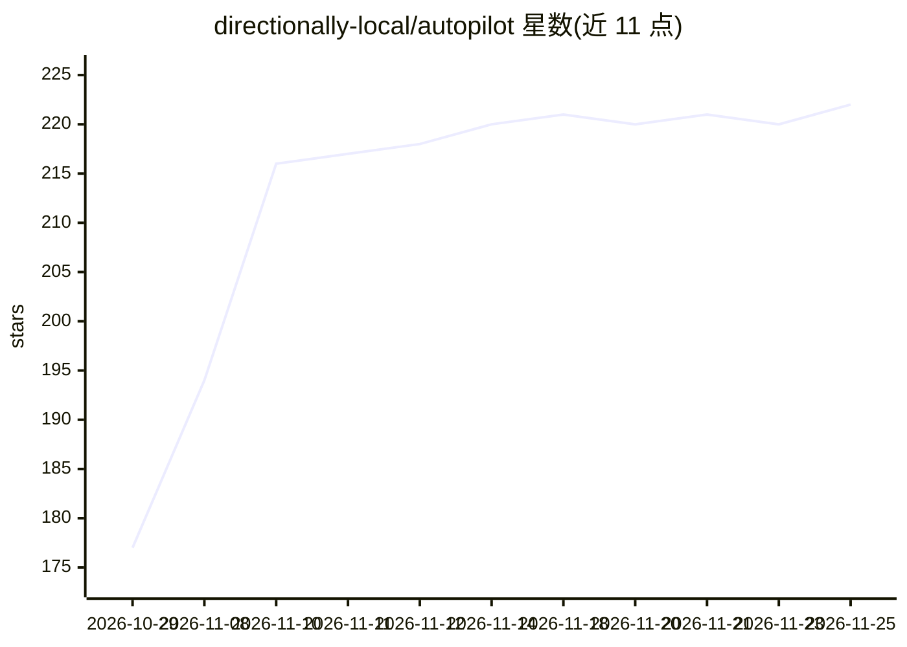

# directionally-local/autopilot

⭐ 222 · TypeScript · MIT · 推送 2026-11-23 · [GitHub](https://github.com/directionally-local/autopilot) · [官网](https://directionallylocal.com/autopilot) · 组织维护

**终端编码 Agent 与 SDK：BYOK 接入 25+ 模型提供方**

TypeScript 编写的开源终端编码 Agent，同时提供 headless SDK（createAgentSession API 与 JSONL-over-stdio RPC）。模型接入采用 BYOK：首次运行选择提供方并保存 key，推荐 OpenRouter 为默认，也可通过 dl 在本地 NVIDIA GPU（≥24GB）上部署 vLLM 模型。功能含 Plan/Edit/Auto 模式、沙箱化子代理、LSP+MCP 扩展、SQLite+embeddings 跨会话记忆、破坏性操作护栏与 /undo、长时无人值守运行。经 curl 脚本（dl 安装器）、npm、Homebrew 或 npx 运行。

## 筛选速览

| 维度 | 判定 | 备注 |
|---|---|---|
| AI 角色 | `ai-native` | 本体是模型或模型工具 |
| 许可风险 | `permissive` | MIT |
| 部署形态 | `desktop` | 安装包/桌面程序 |
| 模型依赖 | local-ok | 支持本地模型 |
| 硬件要求 | — | 无带数字的原话,不猜 |
| 安装摩擦 | `low` | 无编译、无系统依赖或容器化 |
| 成熟度 | — | 结构信号不足 |

## 能力要点

- BYOK 直连 25+ 提供方，OpenRouter 单 key 访问其全部模型目录并按轮显示实际计费成本
- plan/edit/auto 三模式与只读白名单；凭据文件读取、内网地址访问均需确认
- 子代理委派、LSP+MCP 扩展、SQLite+embeddings 跨会话记忆
- 破坏性 git/文件操作前保存恢复点并支持 /undo，附 /audit 风险报告

## 适用场景

- 在终端里用自有 API key 运行编码 Agent 改代码
- 通过 vLLM 在自己 GPU 上跑私有模型并接入 Agent
- 用 headless SDK 与 JSONL RPC 在其上构建程序化 Agent
- 长时无人值守任务配合检查点与预算控制

## 场景标签

`编码 Agent` · 领域:编码与开发

## 证据(README 行号)

> L14:  The open-source coding agent inside dl. It doesn't ask permission.
> L31: On the free tier, model calls go through Directionally Local's free tier service to its model host; it keeps usage 
> L65: - **Headless SDK** — Programmatic `createAgentSession` API and JSONL-over-stdio RPC mode for building on top of aut

## 星数曲线

2026-10-29 177 → 2026-11-25 222（+45）

---
*卡片 v1 · prompt 1.4 · 生成 2026-11-25 · 置信度 high · 依据 README sha `f7aa57575fa0` · [字段定义](../../DATASET.md)*
