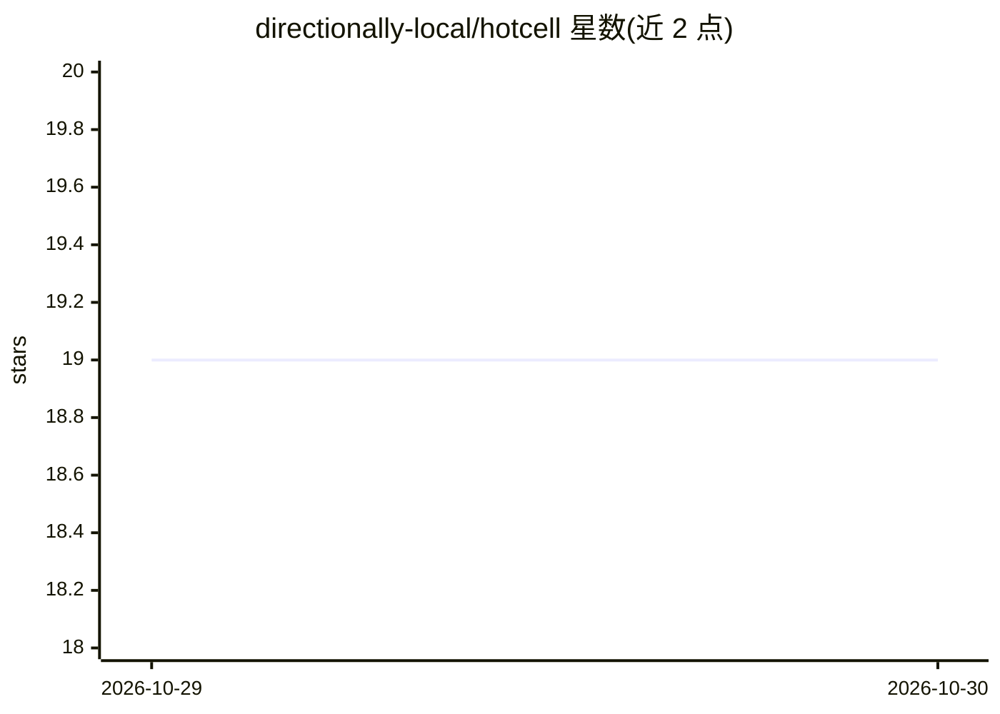

# directionally-local/hotcell

⭐ 19 · TypeScript · Apache-2.0 · 推送 2026-10-29 · [GitHub](https://github.com/directionally-local/hotcell) · [官网](https://directionallylocal.com/hotcell/) · 组织维护

**自托管的 AI agent 沙箱管理工具：硬件上批量隔离运行 agent**

在自有硬件（Mac Mini、云 VM、裸金属机）上创建隔离的 agent 沙箱，支持 Docker、Firecracker（Linux/KVM）与 Apple VZ（macOS）三种运行时。核心机制是网关代发：真实 API key 留在宿主机，沙箱内只见短期令牌，网关换回真实 key 并计量与限额；支持默认拒绝出口、准入控制防超售。可一次创建多个沙箱各挂独立分支，配合 Autopilot 等编码 agent 使用。npm 全局安装，30 秒引导配置；提供 Python SDK。限制：非 HTTP 协议（Postgres/Redis）、SigV4 签名等无法走网关。

## 筛选速览

| 维度 | 判定 | 备注 |
|---|---|---|
| AI 角色 | `ai-ecosystem` | LLM/agent 周边工具 |
| 许可风险 | `permissive` | Apache-2.0 |
| 部署形态 | `self-host` | docker 或自建部署 |
| 模型依赖 | locked-api |  |
| 硬件要求 | — | 无带数字的原话,不猜 |
| 安装摩擦 | `low` | 无编译、无系统依赖或容器化 |
| 成熟度 | — | 结构信号不足 |

## 能力要点

- Docker / Firecracker / Apple VZ 三种运行时统一接口
- 真实 API key 不进沙箱：网关令牌替换、计量、限额、可吊销
- 一次创建多个隔离沙箱，各自独立分支克隆同一仓库
- 默认拒绝出口控制与防超售准入控制

## 适用场景

- 在本地硬件上并行跑多个编码 agent 各做不同特性
- 避免把真实 API key 暴露给 agent 沙箱
- 按沙箱计量与限制 LLM 调用开销

## 场景标签

 · 领域:AI 基础设施/沙箱隔离

## 证据(README 行号)

> L8: **Sandboxes for AI agents, on your own hardware.** A Mac Mini on your desk, a cloud VM, a bare-metal box — as many i
> L56: - **Keys stay out.** Sandboxes reach LLMs and GitHub through a gateway that swaps a per-sandbox token for the real 
> L58: - **Containers or microVMs** — Docker everywhere, Firecracker (Linux/KVM) and Apple VZ (macOS) for VM-grade isolati

## 星数曲线

2026-10-29 19 → 2026-10-30 19（+0）

---
*卡片 v1 · prompt 1.4 · 生成 2026-10-30 · 置信度 mid · 依据 README sha `d80c2b45c63b` · [字段定义](../../DATASET.md)*
