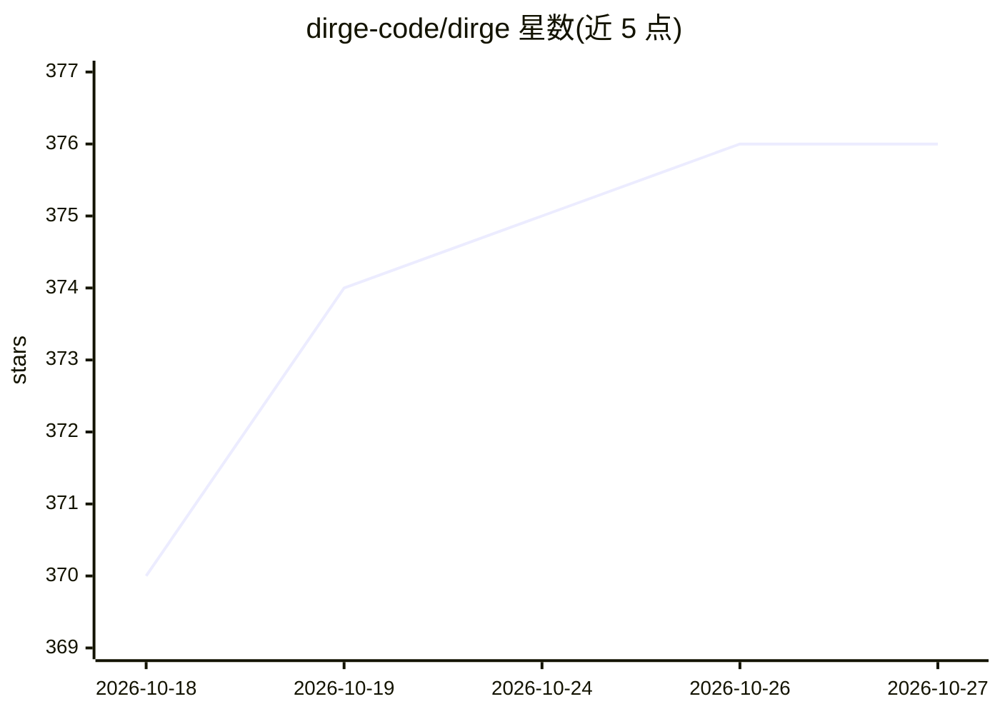

# dirge-code/dirge

⭐ 376 · Rust · GPL-3.0 · 推送 2026-10-26 · [GitHub](https://github.com/dirge-code/dirge) · 组织维护

**Rust 编写的轻量终端编码 agent，带跨会话记忆**

用 Rust 实现的命令行编码 agent：主循环、审查、升级、摘要等角色可路由到不同模型（Cerebras/DeepSeek/GLM/Anthropic/OpenAI/Ollama/OpenAI 兼容端点）。内置 tree-sitter 写前校验、LSP 诊断、单一策略决策点的权限引擎、Janet 插件系统、持久化项目记忆与 SQLite FTS5 检索、agent 看板任务、可恢复会话检查点；无向量索引，上下文默认预算 250k token。支持 cargo/Homebrew/Nix 安装，提供各平台预编译二进制；源码构建需 C/LLVM 工具链。可通过 `dirge mcp` 作为 MCP server 被其他 agent 调用。

## 筛选速览

| 维度 | 判定 | 备注 |
|---|---|---|
| AI 角色 | `ai-native` | 本体是模型或模型工具 |
| 许可风险 | `viral` | GPL-3.0 |
| 部署形态 | `library` | 以包/库形式分发 |
| 模型依赖 | local-ok | 支持本地模型 |
| 硬件要求 | — | 无带数字的原话,不猜 |
| 安装摩擦 | `medium` | 含编译或系统依赖之一 |
| 成熟度 | — | 结构信号不足 |

## 能力要点

- 空闲约 8 MB 内存、36 MB 二件的原生 Rust 实现
- 角色级多模型路由，含失败升级到更强模型与熔断机制
- 两层持久化记忆（inline + FTS5 面包屑索引）与会话检查点恢复
- tree-sitter 写前校验与 LSP 诊断覆盖 10+ 语言
- Janet 运行时插件与 Claude 兼容 skills 按需加载

## 适用场景

- 在终端让 agent 完成编码任务并修复编译错误
- 用较便宜的模型跑长任务，靠记忆与护栏保持稳定
- 让 Claude Code 等规划型 agent 通过 MCP 委派实现任务给 dirge
- 跨会话保留项目偏好与踩坑记录

## 场景标签

`编码 Agent` · 领域:编码与开发

## 证据(README 行号)

> L3: A minimal, fast coding agent written in Rust — inspired by pi, opencode, and maki.
> L14: - **Role-based multi-provider routing.** Point the main loop, review, escalation, summarization, and subagent roles

## 星数曲线

2026-10-18 370 → 2026-10-27 376（+6）

---
*卡片 v1 · prompt 1.4 · 生成 2026-10-22 · 置信度 high · 依据 README sha `c734a41486e0` · [字段定义](../../DATASET.md)*
