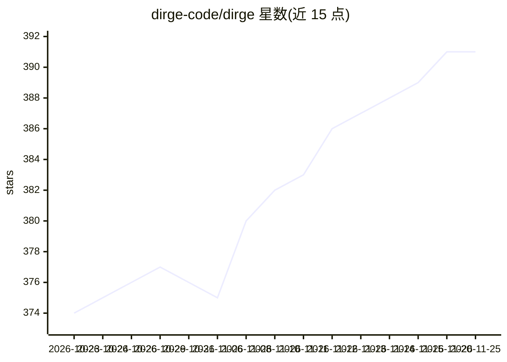

# dirge-code/dirge

⭐ 391 · Rust · GPL-3.0 · 推送 2026-11-23 · [GitHub](https://github.com/dirge-code/dirge) · 个人维护

**Rust 编写的极简编码 agent：多模型路由+跨会话项目记忆**

以 Rust 实现的终端编码 agent，主打低内存占用（空闲约 8MB、二进制约 36MB）与弱模型的容错运行：修复畸形工具调用、写入前经 tree-sitter 校验、重复失败时升级到更强模型。机制包括单一策略决策点的权限引擎、按角色多提供商路由、持久化项目记忆与会话检查点、SQLite FTS5 记忆检索（无向量索引，作者声明为有意设计）、内置 issue 看板、Janet 插件系统与 MCP server 模式。安装途径有 cargo、Homebrew、Nix flake 与各平台预编译二进制；源码构建需 C 编译器与 libclang。

## 筛选速览

| 维度 | 判定 | 备注 |
|---|---|---|
| AI 角色 | `ai-native` | 本体是模型或模型工具 |
| 许可风险 | `viral` | GPL-3.0 |
| 部署形态 | `library` | 以包/库形式分发 |
| 模型依赖 | local-ok | 支持本地模型 |
| 硬件要求 | — | 无带数字的原话,不猜 |
| 安装摩擦 | `medium` | 含编译或系统依赖之一 |
| 成熟度 | — | 结构信号不足 |

## 能力要点

- 按角色多提供商路由：主循环/评审/升级/摘要可指向不同模型，支持 Cerebras、DeepSeek、GLM、Anthropic、OpenAI、Ollama 及任意 OpenAI 兼容端点
- 250k 默认上下文预算与增量检查点，长会话可恢复到活动状态
- 持久化两级项目记忆（SQLite FTS5 检索），会话后编排器抽取学习成果
- tree-sitter 写入校验、LSP 诊断、权限策略可追溯（/why）

## 适用场景

- 在终端中用多个模型协作完成代码修改与评审
- 希望 agent 在多次会话间保留项目偏好与教训
- 让 planner 型 agent 通过 MCP 把实现任务委派给 dirge

## 场景标签

`编码 Agent` · 领域:编码与开发

## 证据(README 行号)

> L3: A minimal, fast coding agent written in Rust — inspired by pi, opencode, and maki.
> L11: - **Tiny and fast.** Roughly 8 MB RAM idle, 15 MB working, 36 MB binary (approximate, measured on a Linux release b
> L14: - **Role-based multi-provider routing.** Point the main loop, review, escalation, summarization, and subagent roles

## 星数曲线

2026-10-23 374 → 2026-11-25 391（+17）

---
*卡片 v1 · prompt 1.4 · 生成 2026-11-25 · 置信度 high · 依据 README sha `fb544c01189e` · [字段定义](../../DATASET.md)*
