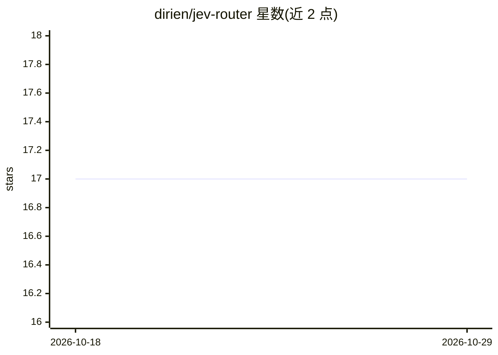

# dirien/jev-router

⭐ 17 · JavaScript · Apache-2.0 · 推送 2026-10-15 · [GitHub](https://github.com/dirien/jev-router) · 个人维护

**本地模型路由代理：为 Claude Code/Codex 按轮次选模型层级**

运行在用户 Mac/Linux 上的直通代理，Claude Code 以 Anthropic Messages 协议、Codex CLI 以 OpenAI Responses 协议接入。每条新的人类消息由 TypeSafe AI 的 Jev 决策模型判定所需层级（fast/balanced/frontier/max），路由到对应模型；会话内只升不降以保留提示缓存。setup 命令安装为 launchd/systemd 后台服务并改写 Claude Code 配置，提供 doctor/launch/uninstall 子命令与本地 127.0.0.1:4100 实时视图。需 Node.js 22+，无运行时依赖，不支持 Docker 之外的容器服务场景时可用 launch 单会话模式。限制：Anthropic 官方不支持将 Claude Code 网关路由至非 Claude 模型（Ollama Cloud 选项除外）。

## 筛选速览

| 维度 | 判定 | 备注 |
|---|---|---|
| AI 角色 | `ai-ecosystem` | LLM/agent 周边工具 |
| 许可风险 | `permissive` | Apache-2.0 |
| 部署形态 | `library` | 以包/库形式分发 |
| 模型依赖 | local-ok | 支持本地模型 |
| 硬件要求 | — | 无带数字的原话,不猜 |
| 安装摩擦 | `low` | 无编译、无系统依赖或容器化 |
| 成熟度 | — | 结构信号不足 |

## 能力要点

- Jev 决策模型按人类消息粒度选择 fast/balanced/frontier/max 层级
- 会话内仅向上切换层级，请求除 model/凭证外原样转发，SSE 字节级回传
- setup 一键安装为 macOS launchd / Linux systemd 用户服务
- 本地 4100 端口实时视图与 doctor 诊断命令

## 适用场景

- 让 Claude Code 或 Codex CLI 按任务难度自动切换模型以控制成本
- 在容器等无用户服务环境中以 launch 模式单会话使用路由
- 通过实时视图查看每条消息的路由决策与原因

## 场景标签

`模型网关` · 领域:Agent 开发

## 证据(README 行号)

> L9: jev-router is a pass-through proxy that runs on your own Mac or Linux machine. Claude Code talks to it in Anthropic
> L29: jev-router is a small server that runs on your machine. Claude Code sends its requests to it instead of to

## 星数曲线

2026-10-18 17 → 2026-10-29 17（+0）

---
*卡片 v1 · prompt 1.4 · 生成 2026-10-29 · 置信度 high · 依据 README sha `20b0d8de0f4d` · [字段定义](../../DATASET.md)*
