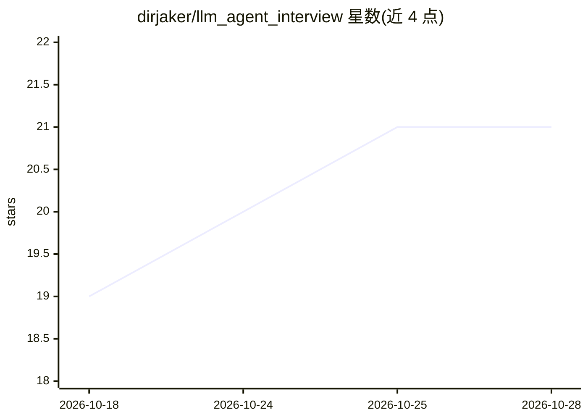

# dirjaker/llm_agent_interview

⭐ 21 · MIT · 推送 2026-06-29 · [GitHub](https://github.com/dirjaker/llm_agent_interview) · 个人维护 · 中文 README

**LLM 应用与 Agent 开发面试题学习知识库**

面向准备 LLM/Agent 岗位面试的开发者的中文面试题合集：覆盖 47 个专题、600+ 道题（含解答、追问场景、代码示例）、82,000+ 行内容，主题从 Python、LLM 原理、Prompt/RAG/Agent、微调部署到 FastAPI 工程化、CICD、LLM 网关运维。提供 11 阶段学习路径、9 个工具（速查表、Top50 高频题、术语表等）。内容以 Markdown 编写，用 VitePress 构建文档站点，部署在 GitHub Pages；通过 git clone 获取源码。MIT 许可证。

## 筛选速览

| 维度 | 判定 | 备注 |
|---|---|---|
| AI 角色 | `ai-knowledge` | 知识聚合/清单类 |
| 许可风险 | `permissive` | MIT |
| 部署形态 | `None` |  |
| 模型依赖 | — | README 未给出锁定关系 |
| 硬件要求 | — | 无带数字的原话,不猜 |
| 安装摩擦 | `low` | 无编译、无系统依赖或容器化 |
| 成熟度 | — | 结构信号不足 |

## 能力要点

- 47 个专题、600+ 道面试题，含解答与追问场景
- 11 阶段学习路径，从基础知识到网关运维
- 9 个面试工具：速查表、Top50 高频题、120+ 术语表等
- VitePress 文档站点，支持本地搜索

## 适用场景

- 系统准备 LLM 应用与 Agent 开发岗位面试
- 按阶段学习从 LLM 原理到生产工程化的知识
- 面试前用速查表和 Top50 高频题快速复习

## 场景标签

`教程课程` · 领域:学习与行业

## 证据(README 行号)

> L14: |📚 **47 个专题**|Python → LLM原理 → Agent → 模型优化 → 工程化 → 生产实战 → 前沿 → 网关运维|
> L15: |📝 **600+ 道题**|精选高频面试题，含详细解答、追问场景、代码示例|

## 星数曲线

2026-10-18 19 → 2026-10-28 21（+2）

---
*卡片 v1 · prompt 1.4 · 生成 2026-10-28 · 置信度 high · 依据 README sha `c5f9aa35c248` · [字段定义](../../DATASET.md)*
