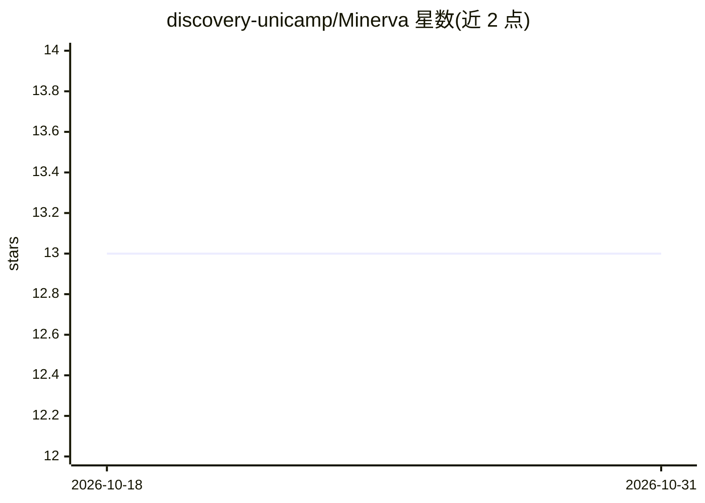

# discovery-unicamp/Minerva

⭐ 13 · Python · MIT · 推送 2026-10-20 · [GitHub](https://github.com/discovery-unicamp/Minerva) · [官网](https://discovery-unicamp.github.io/Minerva/) · 组织维护

**面向科研人员的 PyTorch-Lightning 模型训练框架**

基于 PyTorch-Lightning 的机器学习模型训练框架，面向科研人员，提供模型与架构库、训练评估工具、损失函数、数据读取与变换模块，以及可复现的训练流水线；支持自监督学习（SSL）以应对标注数据有限的情况。通过 PyPI 发布，可用 uv 或 pip 安装，也可克隆源码本地安装；提供基于 VSCode DevContainer 的开发环境。超参数优化、预训练模型与 MLflow 实验管理列为未来功能。

## 筛选速览

| 维度 | 判定 | 备注 |
|---|---|---|
| AI 角色 | `ai-ecosystem` | LLM/agent 周边工具 |
| 许可风险 | `permissive` | MIT |
| 部署形态 | `library` | 以包/库形式分发 |
| 模型依赖 | — | README 未给出锁定关系 |
| 硬件要求 | — | 无带数字的原话,不猜 |
| 安装摩擦 | `low` | 无编译、无系统依赖或容器化 |
| 成熟度 | — | 结构信号不足 |

## 能力要点

- 提供模型、损失、数据变换、分析等多模块的 Python 包结构
- 支持自监督学习（SSL）训练
- 以可复现流水线（版本、配置、日志）组织训练与评估
- 提供预装依赖的 DevContainer 开发环境

## 适用场景

- 科研项目中训练与评估机器学习模型
- 标注数据有限时使用 SSL 方法训练模型
- 以可复现方式管理训练实验

## 场景标签

`模型训练` · 领域:训练与推理

## 证据(README 行号)

> L7: Minerva is a Pytorch-Lightning-based framework for training machine learning models for researchers.
> L23: - **Self-Supervised Learning (SSL) Support**: Minerva supports Self-Supervised Learning (SSL) for training models w

## 星数曲线

2026-10-18 13 → 2026-10-31 13（+0）

---
*卡片 v1 · prompt 1.4 · 生成 2026-10-31 · 置信度 high · 依据 README sha `a2464461a106` · [字段定义](../../DATASET.md)*
