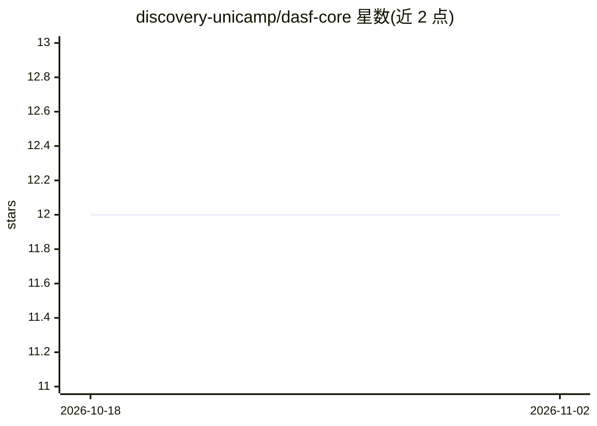

# discovery-unicamp/dasf-core

⭐ 12 · Python · MIT · 推送 2026-10-28 · [GitHub](https://github.com/discovery-unicamp/dasf-core) · 组织维护

**用 Dask 与 RAPIDS 加速扩展机器学习算法的 Python 框架**

DASF 是面向机器学习算法加速与扩展的 Python 通用框架：通过 Dask 实现分布式计算（多 CPU），通过 RAPIDS AI 实现 GPU 加速。以容器方式（Docker/Singularity + HPCCM）为推荐安装途径，构建后启动 Jupyter Server 使用；也可 pip 本地安装用于开发。支持 K-Means、DBSCAN、PCA、SVM、Boosted Trees、最近邻等算法，各有 CPU/GPU/多 CPU/多 GPU 不同支持组合，按 dasf.ml.* 模块路径组织。由 UNICAMP 团队维护，附地震大数据论文引用。

## 筛选速览

| 维度 | 判定 | 备注 |
|---|---|---|
| AI 角色 | `ai-ecosystem` | LLM/agent 周边工具 |
| 许可风险 | `permissive` | MIT |
| 部署形态 | `library` | 以包/库形式分发 |
| 模型依赖 | — | README 未给出锁定关系 |
| 硬件要求 | — | 无带数字的原话,不猜 |
| 安装摩擦 | `low` | 无编译、无系统依赖或容器化 |
| 成熟度 | — | 结构信号不足 |

## 能力要点

- 基于 Dask 的分布式与 RAPIDS AI 的 GPU 加速
- 覆盖聚类、降维、SVM、Boosted Trees 等算法，标注 CPU/GPU/多 CPU/多 GPU 支持矩阵
- Docker/Singularity + HPCCM 预配置容器，含 Jupyter Server 启动脚本
- 支持按 cpu/gpu 设备类型选择构建

## 适用场景

- 在 GPU 或多节点环境加速聚类、降维等机器学习算法
- 处理更大规模数据集的分布式 ML 计算
- 在 Jupyter 容器环境中实验分布式机器学习

## 场景标签

 · 领域:机器学习/分布式计算

## 证据(README 行号)

> L10: DASF is a powerful, generic framework designed to accelerate and scale common machine learning techniques. By lever
> L96: |**ML Algorithm**|**CPU**|**GPU**|**Multi-CPU**|**Multi-GPU**|**Path**|

## 星数曲线

2026-10-18 12 → 2026-11-02 12（+0）

---
*卡片 v1 · prompt 1.4 · 生成 2026-11-01 · 置信度 mid · 依据 README sha `d848b124949d` · [字段定义](../../DATASET.md)*
