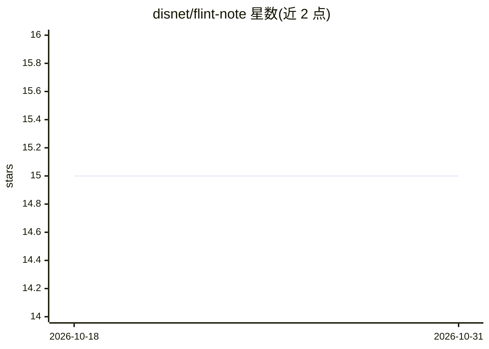

# disnet/flint-note

⭐ 15 · TypeScript · GPL-3.0 · 推送 2026-10-24 · [GitHub](https://github.com/disnet/flint-note) · [官网](https://www.flintnote.com) · 个人维护

**本地优先的 Markdown 笔记应用，AI 辅助连接与回顾笔记**

基于 Electron、Svelte 5 与 TypeScript 构建的笔记应用，围绕外化、内化、重现三阶段的学习循环设计：无障碍记录想法、通过连接与反思内化、按间隔重现以巩固记忆。AI 定位为结构化任务的辅助而非替代。笔记为 Markdown 纯文本，数据存储在本机，遵循 GPL-3.0 开源。README 声明当前处于 beta 阶段，存在 bug 与未完成细节。通过 npm install 从源码构建运行，支持命令行参数打开指定 vault。

## 筛选速览

| 维度 | 判定 | 备注 |
|---|---|---|
| AI 角色 | `ai-enhanced` | 去掉 AI 部分产品仍成立 |
| 许可风险 | `viral` | GPL-3.0 |
| 部署形态 | `library` | 以包/库形式分发 |
| 模型依赖 | — | README 未给出锁定关系 |
| 硬件要求 | — | 无带数字的原话,不猜 |
| 安装摩擦 | `low` | 无编译、无系统依赖或容器化 |
| 成熟度 | `idea` | |

## 能力要点

- 围绕外化-内化-重现完整学习循环设计
- Markdown 纯文本存储、本地优先、无专有格式
- AI 定位为结构化任务辅助（Agent assistance, not replacement）
- 支持命令行参数（如 --vault）用于自动化与脚本

## 适用场景

- 记录想法并建立笔记间的连接
- 按间隔重现旧笔记以巩固记忆
- 用自己拥有的 Markdown 文件管理知识库，数据不出本机

## 场景标签

`知识库管理` · 领域:知识与检索

## 证据(README 行号)

> L6: Flint is a note-taking app that helps you capture ideas, connect them together, and make them part of how you think.
> L37: - **Agent assistance, not replacement** - AI helps with structural tasks while you think
> L39: - **Plain text first** - Markdown files you own, no proprietary formats
> L40: - **Local-first** - Your data stays on your machine

## 星数曲线

2026-10-18 15 → 2026-10-31 15（+0）

---
*卡片 v1 · prompt 1.4 · 生成 2026-10-30 · 置信度 high · 依据 README sha `7075291745b1` · [字段定义](../../DATASET.md)*
