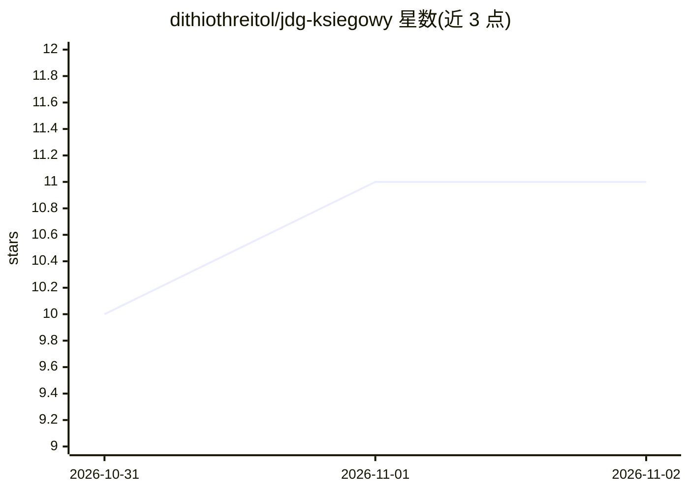

# dithiothreitol/jdg-ksiegowy

⭐ 11 · Python · MIT · 推送 2026-10-20 · [GitHub](https://github.com/dithiothreitol/jdg-ksiegowy) · 个人维护

**面向波兰个体户（JDG）的开源 AI 记账助手**

自托管的聊天式记账助手，覆盖波兰个体户月度流程：开具 FA(3) 发票并提交 KSeF 2.0、费用登记与 OCR 识别（本地 Pixtral 12B，Claude Haiku 4.5 兜底）、生成 JPK_V7M/JPK_EWP/ZUS DRA/PIT-28 并通过 MF Gateway REST 提交、银行 CSV 对账、税款计算器与截止日期面板。通过 OpenClaw 网关接入 WhatsApp/Telegram/Slack，模型可换（默认 Ollama 本地运行）。LLM 只做意图识别与文档理解，税务计算全部由 Decimal 确定性 Python 完成；180 个 pytest 测试通过，KSeF/MF Gateway 沙箱已端到端验证。cron 提醒与推送告警尚未接线。

## 筛选速览

| 维度 | 判定 | 备注 |
|---|---|---|
| AI 角色 | `ai-native` | 本体是模型或模型工具 |
| 许可风险 | `permissive` | MIT |
| 部署形态 | `library` | 以包/库形式分发 |
| 模型依赖 | local-ok | 支持本地模型 |
| 硬件要求 | — | 无带数字的原话,不猜 |
| 安装摩擦 | `low` | 无编译、无系统依赖或容器化 |
| 成熟度 | `idea` | |

## 能力要点

- FA(3) 发票生成与 KSeF 2.0 在线会话提交（含 UPO 回执）
- JPK_V7M/EWP、ZUS DRA、PIT-28 生成与 MF Gateway REST 直投
- LLM 仅做意图识别与 OCR，税务数字全部 Decimal 确定性计算
- OCR 用本地 Pixtral 12B（CPU 可跑），Claude Haiku 4.5 作兜底

## 适用场景

- 在 Telegram/WhatsApp 里用波兰语开票并自动提交 KSeF
- 自托管替代付费记账 SaaS，数据留在自己服务器
- 扫描采购发票 PDF 自动入费用登记并抵扣进项 VAT
- 按月生成并提交 JPK_V7M、ZUS DRA 等申报文件

## 场景标签

`聊天机器人` `OCR` · 领域:对话与助手

## 证据(README 行号)

> L37: **JDG Ksiegowy replaces the core of that workflow** &mdash; self-hosted, AI-first, chat-native, on Ollama (free) or
> L62: - **OCR faktur zakupu** &mdash; multimodal Pixtral 12B lokalnie (CPU inference) + Claude Haiku 4.5 fallback
> L197: Two-tier architecture:

## 星数曲线

2026-10-31 10 → 2026-11-02 11（+1）

---
*卡片 v1 · prompt 1.4 · 生成 2026-11-02 · 置信度 high · 依据 README sha `79b9303f559c` · [字段定义](../../DATASET.md)*
