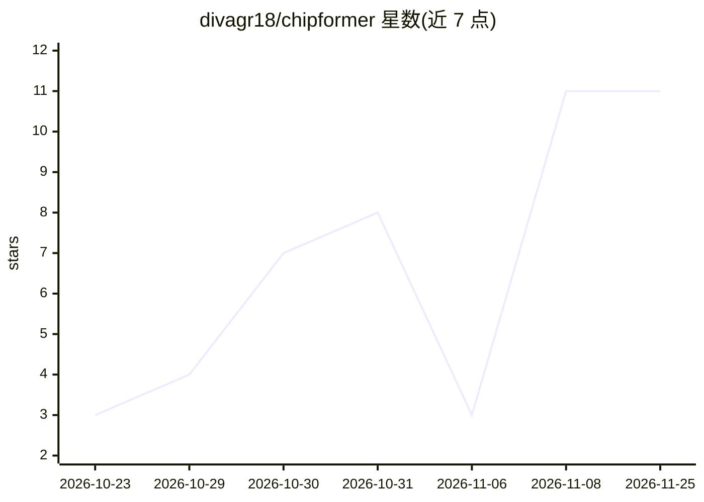

# divagr18/chipformer

⭐ 11 · Python · NOASSERTION · 推送 2026-10-30 · [GitHub](https://github.com/divagr18/chipformer) · [官网](https://divagr.com/chipformer) · 个人维护

**把 CHIP-8 计算机编译进 transformer 权重并实时玩游戏**

chipformer 是一个作为 CHIP-8 计算机运行的 transformer：游戏 ROM 作为提示输入，模型逐步预测对内存的每次写入（寄存器、程序计数器、像素行），据此绘制 64×32 屏幕输出游戏画面，无模拟器参与推理。一个 32.3M 参数模型可实时运行 Tetris、Pong 等 119 款游戏。权重由 DSL 编译而非学习得到，保证每条指令精确；提供桌面单文件程序、浏览器演示、Hugging Face 检查点和 Rust 推理引擎。不支持 SUPER-CHIP/XO-CHIP 指令与 vBlank quirk。

## 筛选速览

| 维度 | 判定 | 备注 |
|---|---|---|
| AI 角色 | `ai-native` | 本体是模型或模型工具 |
| 许可风险 | `none` | NOASSERTION |
| 部署形态 | `desktop` | 安装包/桌面程序 |
| 模型依赖 | — | README 未给出锁定关系 |
| 硬件要求 | — | 无带数字的原话,不猜 |
| 安装摩擦 | `medium` | 含编译或系统依赖之一 |
| 成熟度 | — | 结构信号不足 |

## 能力要点

- 游戏 ROM 作为提示，模型逐 token 预测内存写入以生成游戏画面
- 单模型实时运行 119 款 CHIP-8 游戏，切换游戏即切换提示
- 权重由电路 DSL 编译生成（约 0.3 秒），输出与参考模拟器逐 token 一致
- Rust 引擎用 Li Chao 树 KV 缓存实现 O(log n) attention

## 适用场景

- 在浏览器或桌面上体验 transformer 内运行的游戏
- 以 transformers 库加载检查点做机制可解释性研究
- 研究编译进权重的电路与精确 attention 实现

## 场景标签

`推理引擎` · 领域:训练与推理

## 证据(README 行号)

> L5: chipformer is a transformer that *is* a CHIP-8 computer. The game goes in as the prompt, and
> L9: comes out of the model. There is no emulator behind it, just the loop every language model runs:
> L101: The weights are compiled rather than learned, which is what makes every instruction exact. The circuit is written 

## 星数曲线

2026-10-23 3 → 2026-11-25 11（+8）

---
*卡片 v1 · prompt 1.4 · 生成 2026-11-18 · 置信度 high · 依据 README sha `deec24d109c4` · [字段定义](../../DATASET.md)*
