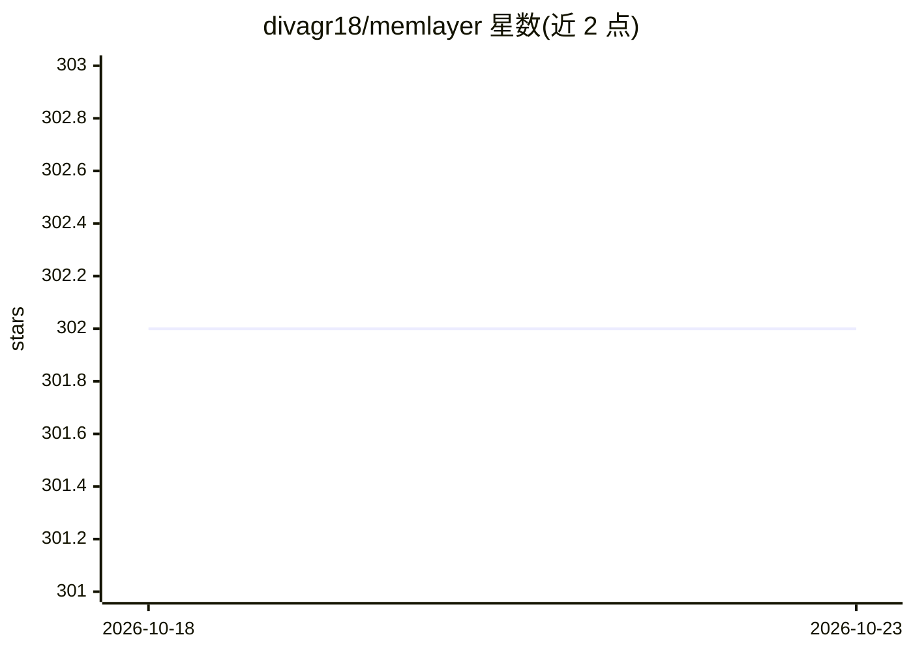

# divagr18/memlayer

⭐ 302 · Python · MIT · 推送 2026-02-02 · [GitHub](https://github.com/divagr18/memlayer) · [官网](https://divagr18.github.io/memlayer/) · 个人维护

**为 LLM 添加持久记忆层的 Python 库，3 行代码接入**

面向开发者的 LLM 记忆层库：以 pip 包提供，包装 OpenAI/Claude/Gemini/Ollama/LMStudio 客户端，自动过滤显著信息、抽取实体关系构建知识图谱，存储于 ChromaDB 向量库与 NetworkX 图数据库，检索时注入上下文。提供 LOCAL/ONLINE/LIGHTWEIGHT 三种运行模式与 Fast/Balanced/Deep 三档检索层级，另有主动任务提醒与搜索追踪观测能力。MIT 许可，Python 3.10+。

## 筛选速览

| 维度 | 判定 | 备注 |
|---|---|---|
| AI 角色 | `ai-ecosystem` | LLM/agent 周边工具 |
| 许可风险 | `permissive` | MIT |
| 部署形态 | `library` | 以包/库形式分发 |
| 模型依赖 | local-ok | 支持本地模型 |
| 硬件要求 | — | 无带数字的原话,不猜 |
| 安装摩擦 | `low` | 无编译、无系统依赖或容器化 |
| 成熟度 | — | 结构信号不足 |

## 能力要点

- 向量相似度 + 知识图谱遍历的混合检索
- 三种运行模式（LOCAL/ONLINE/LIGHTWEIGHT）与三档检索层级（<100ms/<500ms/<2s）
- 自动抽取事实、实体与关系并构建知识图谱
- 支持 OpenAI/Claude/Gemini/Ollama/LMStudio，统一 API

## 适用场景

- 让 agent 跨会话记住用户偏好与事实
- 从对话中自动沉淀结构化知识图谱
- 本地离线运行带记忆的 LLM 应用

## 场景标签

`Agent 记忆` · 领域:Agent 开发

## 证据(README 行号)

> L5: Memlayer adds persistent, intelligent memory to any LLM in just 3 lines of code, enabling agents that recall context
> L21: - **Universal LLM Support**: Works with OpenAI, Claude, Gemini, Ollama models

## 星数曲线

2026-10-18 302 → 2026-10-23 302（+0）

---
*卡片 v1 · prompt 1.4 · 生成 2026-10-21 · 置信度 high · 依据 README sha `73f7dcd354b1` · [字段定义](../../DATASET.md)*
