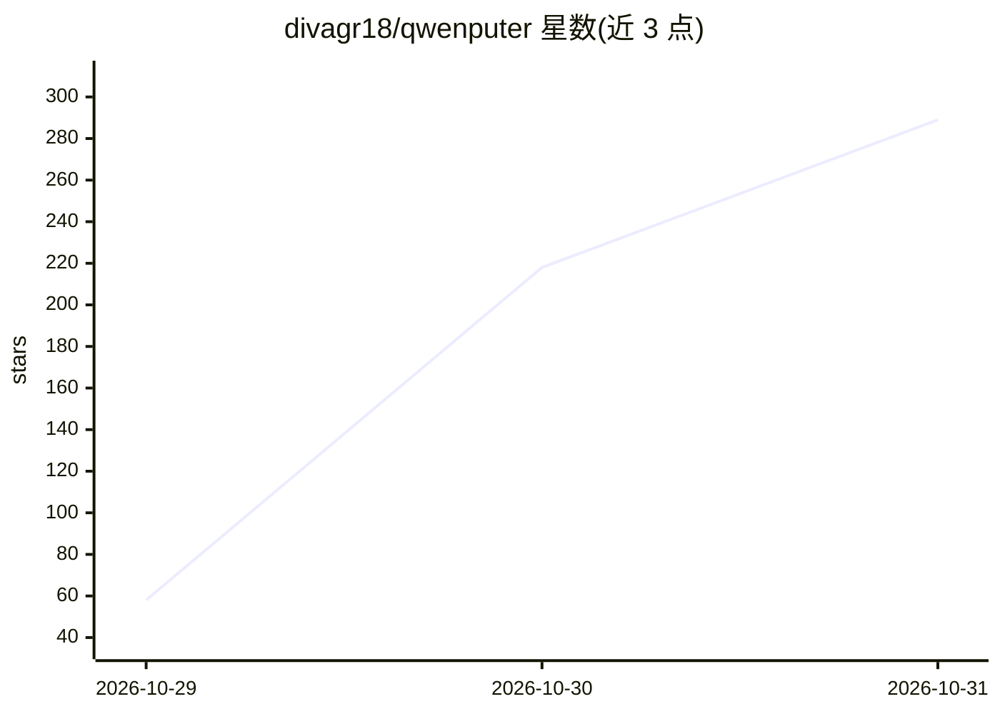

# divagr18/qwenputer

⭐ 289 · Python · NOASSERTION · 推送 2026-10-30 · [GitHub](https://github.com/divagr18/qwenputer) · 个人维护

**把 RISC-V CPU 编译进语言模型权重的实验模型：模型内精确计算**

基于 Qwen3.5-4B 的实验模型：用编译器（非训练）在模型前插入 11 层 transformer 层，实现 RV32IM CPU，以模型自身的 Gated DeltaNet 状态作为 RAM，在 forward pass 内运行 C/MicroPython 代码，通过官方 riscv-tests。Qwen 以工具调用语法发起计算，但无外部运行时执行，模型自身逐 token 写出精确答案。另有在权重内的实验性文件系统（最多 512 文件、约 53,000 token）。面向可解释性与模型架构研究，提供 Hugging Face/ModelScope 权重下载与 git clone + uv 运行方式。合并后模型 14.65 GB（基座 9.3 GB），零权重占比高。

## 筛选速览

| 维度 | 判定 | 备注 |
|---|---|---|
| AI 角色 | `ai-native` | 本体是模型或模型工具 |
| 许可风险 | `none` | NOASSERTION |
| 部署形态 | `None` |  |
| 模型依赖 | — | README 未给出锁定关系 |
| 硬件要求 | — | 无带数字的原话,不猜 |
| 安装摩擦 | `low` | 无编译、无系统依赖或容器化 |
| 成熟度 | `idea` | |

## 能力要点

- 编译器生成的 11 层 transformer 实现 RV32IM CPU（Zba + bignum 协处理器）
- Gated DeltaNet 状态作为 RAM，寄存器/程序计数器/栈各占独立头
- 无外部工具调用：模型在 tool_call 语法下自身生成精确 tool_response
- 实验性权重内文件系统：put/append/get/list/delete 五个工具，支持跨会话保存

## 适用场景

- 研究线性注意力/DeltaNet 状态作为可寻址内存的机制
- 对比模型内精确计算与外部 Python 工具的算术基准表现
- 在模型权重内运行 RISC-V 固件做可解释性实验

## 场景标签

`科研工具` · 领域:学习与行业

## 证据(README 行号)

> L6: **Qwenputer is a new kind of experimental model: Qwen3.5-4B with a 32-bit RISC-V CPU compiled and
> L8: transformer layers in front of Qwen's own, and none of their weights are learned: a compiler
> L15: The CPU runs C and MicroPython code inside the model's forward passes, and passes the official

## 星数曲线

2026-10-29 58 → 2026-10-31 289（+231）

---
*卡片 v1 · prompt 1.4 · 生成 2026-10-28 · 置信度 high · 依据 README sha `c653bd09502b` · [字段定义](../../DATASET.md)*
